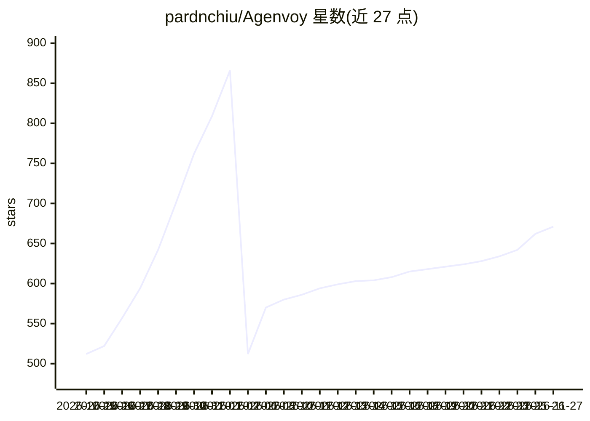

# pardnchiu/Agenvoy

⭐ 671 · Go · AGPL-3.0 · 推送 2026-11-26 · [GitHub](https://github.com/pardnchiu/Agenvoy) · [官网](https://agenvoy.com/) · 个人维护 · 中文 README

**本机 24/7 运行的 AI agent harness，自动生成工具并共享给 MCP agent**

以单个 Go 二进制提供的本地 AI agent harness：作为守护进程在用户自己的机器上运行，会话、记忆、计划任务存于本地 SQLite，API key 存于 OS keychain，命令默认在 macOS sandbox-exec / Linux bubblewrap 沙箱执行。用户一句话描述需求，agent 拆解步骤、调用或自动编写并沙箱测试工具；内置 40 个工具、三层记忆、cron 调度、语音交互、Telegram/Discord 外联通道，并以 MCP server 身份把工具库共享给 Claude Code、Codex 等 agent。支持 11 个模型提供商及任意 OpenAI 兼容端点。Windows 需经 WSL，Android 经内置 Terminal 或 Termux+Ubuntu 运行。

## 筛选速览

| 维度 | 判定 | 备注 |
|---|---|---|
| AI 角色 | `ai-native` | 本体是模型或模型工具 |
| 许可风险 | `dual` | AGPL-3.0 |
| 部署形态 | `None` |  |
| 模型依赖 | local-ok | 支持本地模型 |
| 硬件要求 | — | 无带数字的原话,不猜 |
| 安装摩擦 | `low` | 无编译、无系统依赖或容器化 |
| 成熟度 | `idea` | |

## 能力要点

- 无可用工具时自动调用无密钥公共 API 或编写并沙箱测试新工具
- MCP server 使 Claude Code/Codex/OpenCode 等复用同一工具库
- 三层记忆：上下文窗口、语义向量检索与 SQLite 全文归档
- 数据本地化：本地守护进程外联 Telegram/Discord，不开放入站端口

## 适用场景

- 一句话创建定时任务并推送结果到聊天软件
- 让 agent 检索本地文件并回答（RAG）
- 在多个 AI agent 之间共享沙箱化工具库
- 通过订阅账号（Copilot/Claude/ChatGPT）接入模型而不办新 API key

## 场景标签

`AI 助手` `RAG` `Agent 框架` · 领域:Agent 开发

## 证据(README 行号)

> L87: Agenvoy is a Taiwan-developed AI Agent Harness by Pardn Chiu, built to turn conversation into completed work on you
> L210: |Auto tool generation|Calls a public API, or writes, sandbox-tests and registers a tool when none fits|
> L246: Eleven model providers behind one interface, plus as many OpenAI-compatible endpoints as you want. Subscription ro

## 星数曲线

2026-10-25 512 → 2026-11-27 671（+159）

---
*卡片 v1 · prompt 1.4 · 生成 2026-11-26 · 置信度 high · 依据 README sha `cf9f2da5a22b` · [字段定义](../../DATASET.md)*
