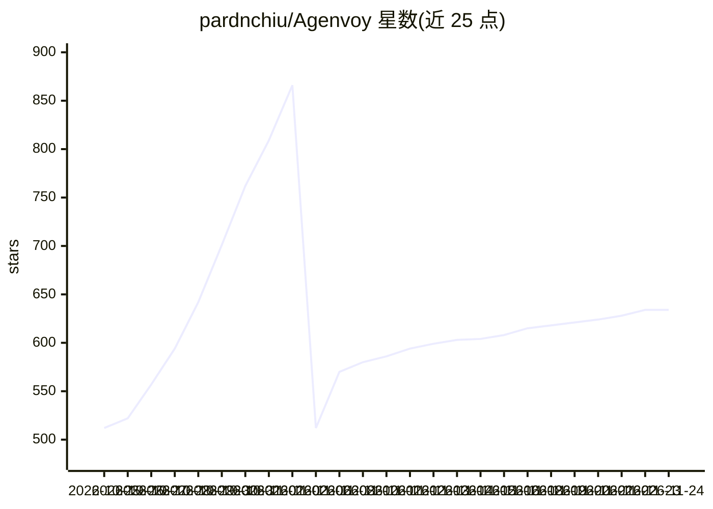

# pardnchiu/Agenvoy

⭐ 634 · Go · AGPL-3.0 · 推送 2026-11-22 · [GitHub](https://github.com/pardnchiu/Agenvoy) · [官网](https://agenvoy.com/) · 个人维护 · 中文 README

**本地常驻运行的 AI agent harness，自动构建工具并经 MCP 共享**

以单个 Go 二进制运行的本地 daemon，把一句话请求拆解为步骤并调用工具交付结果：无现成工具时先调用无密钥公共 API，否则自动编写脚本工具并在沙箱中测试后复用。内置 MCP server/client、按任务路由的多模型调度、三层记忆、cron 调度器、37 个内置工具与 Web 仪表盘（含实时语音）。数据存于本地 SQLite，凭据放 OS keychain，命令在 sandbox-exec/bwrap 沙箱中运行。亦可将工具暴露给 Claude Code、Codex 等 agent。当前处于 review-and-cleanup 阶段。

## 筛选速览

| 维度 | 判定 | 备注 |
|---|---|---|
| AI 角色 | `ai-ecosystem` | LLM/agent 周边工具 |
| 许可风险 | `dual` | AGPL-3.0 |
| 部署形态 | `None` |  |
| 模型依赖 | local-ok | 支持本地模型 |
| 硬件要求 | — | 无带数字的原话,不猜 |
| 安装摩擦 | `low` | 无编译、无系统依赖或容器化 |
| 成熟度 | `idea` | |

## 能力要点

- 无工具可用时自动编写、沙箱测试并注册新工具
- 作为 MCP server 向 Claude Code/Codex/OpenCode 等共享沙箱工具库
- 11 家模型提供商统一接口，订阅 OAuth（Copilot/Codex/xAI）或本地 Ollama/LM Studio 接入
- 单句创建 cron 调度，结果可推送 Telegram/Discord

## 适用场景

- 在本地机器 24/7 运行定时任务并推送结果到聊天软件
- 让多个 AI agent 共享同一套已验证的脚本工具
- 对本地文件提问并检索（RAG）
- 通过 Telegram/Discord 在外部访问家中运行的 agent

## 场景标签

`AI 助手` `RAG` `多智能体` `模型网关` · 领域:Agent 开发

## 证据(README 行号)

> L59: Agenvoy is a Taiwan-developed AI Agent Harness by Pardn Chiu, built to turn conversation into completed work on you
> L183: |MCP server & client|Shares every sandboxed tool with Claude Code, Codex and any MCP client; calls external MCP se
> L184: |Multi-model dispatch|Eleven providers behind one interface plus any OpenAI-compatible endpoint; each task is rout

## 星数曲线

2026-10-25 512 → 2026-11-24 634（+122）

---
*卡片 v1 · prompt 1.4 · 生成 2026-11-24 · 置信度 high · 依据 README sha `3bd7a8b03b58` · [字段定义](../../DATASET.md)*
