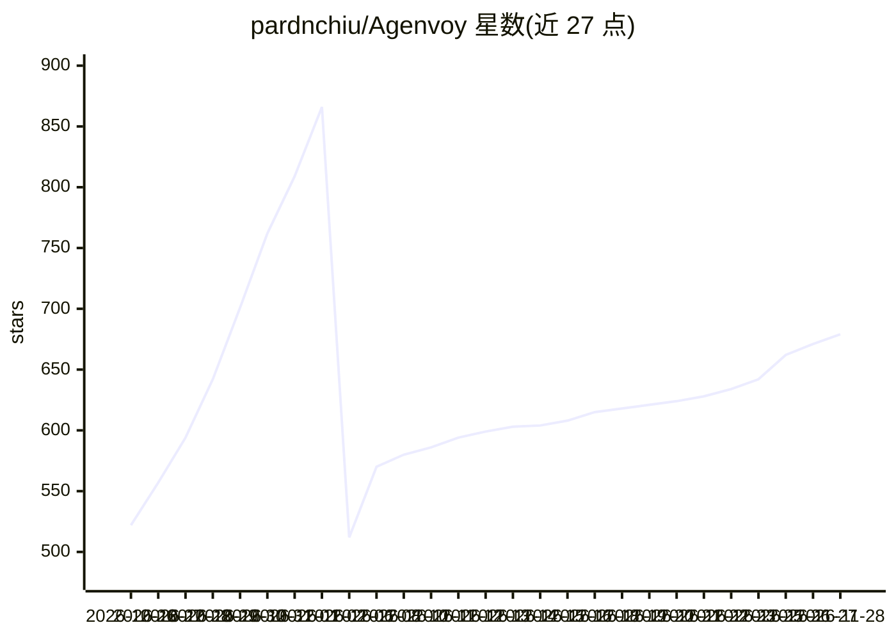

# pardnchiu/Agenvoy

⭐ 679 · Go · AGPL-3.0 · 推送 2026-11-27 · [GitHub](https://github.com/pardnchiu/Agenvoy) · [官网](https://agenvoy.com/) · 个人维护 · 中文 README

**本机常驻的本地 AI agent 运行器，自动生成工具并共享给 MCP agent**

以单个 Go 二进制形式在本机以守护进程运行 24/7 的 AI agent harness：把一句话请求拆解为步骤，调用工具并交付结果；无合适工具时先调用无密钥公共 API，否则自动编写脚本工具并在沙箱中测试后复用。内置调度器、三层记忆、技能与子 agent、生命周期钩子，并作为 MCP server 将工具库共享给 Claude Code、Codex 等 agent。数据存于本机 SQLite，命令在 OS 沙箱执行，支持 TUI、Web 面板、Telegram/Discord 与 OpenAI 兼容 REST API 访问。README 注明当前处于 review-and-cleanup 阶段。

## 筛选速览

| 维度 | 判定 | 备注 |
|---|---|---|
| AI 角色 | `ai-ecosystem` | LLM/agent 周边工具 |
| 许可风险 | `dual` | AGPL-3.0 |
| 部署形态 | `None` |  |
| 模型依赖 | local-ok | 支持本地模型 |
| 硬件要求 | — | 无带数字的原话,不猜 |
| 安装摩擦 | `low` | 无编译、无系统依赖或容器化 |
| 成熟度 | `idea` | |

## 能力要点

- 自动生成、沙箱测试并注册脚本工具，无代码要求
- 内置 MCP server/client，与 Claude Code、Codex 等共享同一工具库
- 一句话创建一次性与 cron 调度任务，结果推送 Telegram
- 三层记忆：上下文窗口、语义向量检索、SQLite 全文归档

## 适用场景

- 让 agent 在自己电脑上完成检索实时数据、整理文件等多步任务
- 用一句话把重复工作变成定时自动化并推送到 Telegram/Discord
- 对本地文件做搜索与问答（RAG）
- 给 Claude Code、Codex 等多个 agent 提供共享的沙箱工具库

## 场景标签

`AI 助手` `RAG` `工作流自动化` · 领域:效率与自动化

## 证据(README 行号)

> L6:  Say what you need in one sentence; it builds the tool, sandbox-tests it, and shares it with Claude Code, Codex and 
> L87: Agenvoy is a Taiwan-developed AI Agent Harness by Pardn Chiu, built to turn conversation into completed work on you
> L246: Eleven model providers behind one interface, plus as many OpenAI-compatible endpoints as you want. Subscription ro

## 星数曲线

2026-10-26 522 → 2026-11-28 679（+157）

---
*卡片 v1 · prompt 1.4 · 生成 2026-11-28 · 置信度 high · 依据 README sha `ad7342c1912f` · [字段定义](../../DATASET.md)*
