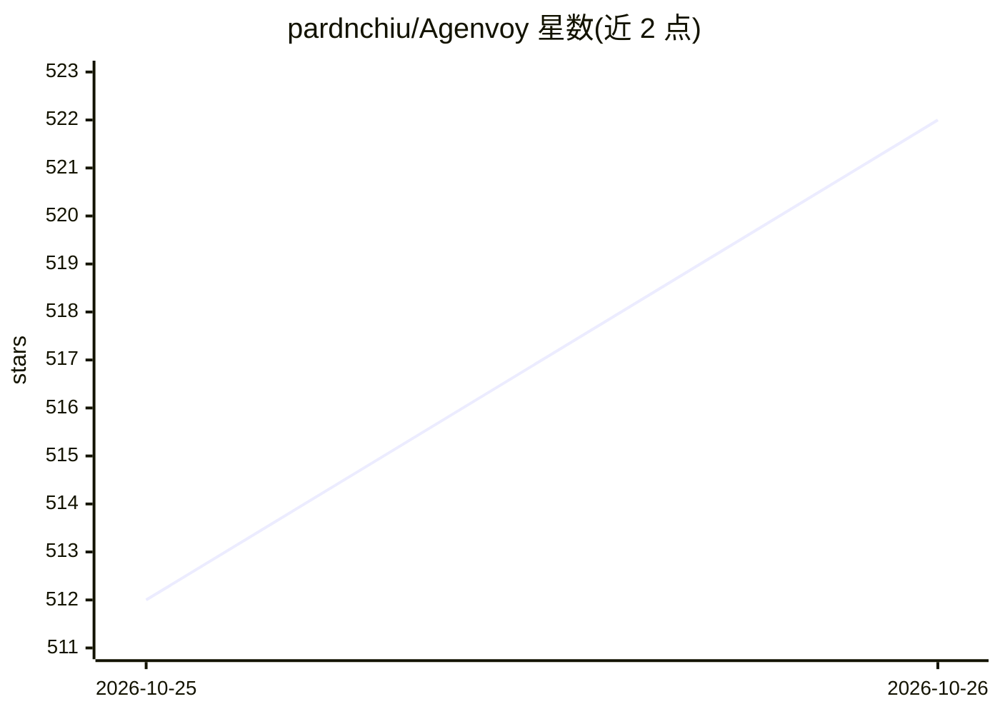

# pardnchiu/Agenvoy

⭐ 522 · Go · AGPL-3.0 · 推送 2026-10-22 · [GitHub](https://github.com/pardnchiu/Agenvoy) · [官网](https://agenvoy.com/) · 个人维护 · 中文 README

**自托管 24/7 本地个人 AI 代理：把对话变成电脑上完成的工作**

用 Go 编写的单二进制自托管 AI Agent Harness，由台湾开发者 Pardn Chiu 维护。它将模型、上下文、工具、调度、记忆与执行编排为一个工作流：缺少工具时自动构建并保存、一句话创建定时任务、本地文件 RAG 检索、子代理协作、摘要式长期记忆。同时作为 MCP server 向 Claude Code、Codex 等代理共享沙箱工具。本地守护进程外连 Telegram/Discord，无需开放入站端口。macOS/Linux 一行脚本安装，Windows 需经 WSL 运行。

## 筛选速览

| 维度 | 判定 | 备注 |
|---|---|---|
| AI 角色 | `ai-native` | 本体是模型或模型工具 |
| 许可风险 | `dual` | AGPL-3.0 |
| 部署形态 | `None` |  |
| 模型依赖 | — | README 未给出锁定关系 |
| 硬件要求 | — | 无带数字的原话,不猜 |
| 安装摩擦 | `low` | 无编译、无系统依赖或容器化 |
| 成熟度 | — | 结构信号不足 |

## 能力要点

- 缺少工具时自动创建、测试并保存为可复用工具
- 同时作为 MCP server 向 Claude Code、Codex 等代理共享沙箱工具库
- 本地守护进程外连 Telegram/Discord，无需暴露入站端口
- Web 仪表盘内置在二进制中，浏览器管理会话、工具、调度与记忆

## 适用场景

- 让 AI 在自己的电脑上完成检索、文件整理和多步任务并交付结果
- 把周期性工作（如每日股价报告）变成一句话创建的定时自动化
- 让 Claude Code、Codex 等已在用的代理共享同一套沙箱工具
- 在外通过 Telegram/Discord 私密访问本地代理

## 场景标签

`AI 助手` `Agent 记忆` `多智能体` `工作流自动化` · 领域:Agent 开发

## 证据(README 行号)

> L5:  Agenvoy is an open-source, self-hosted 24/7 personal AI agent that runs on your own computer — your memory, schedul
> L19: Agenvoy is a Taiwan-developed AI Agent Harness by Pardn Chiu, built to turn conversation into completed work on you
> L25: - **Turns conversation into deliverable work** — Research live data, organize files, and complete multi-step tasks 

## 星数曲线

2026-10-25 512 → 2026-10-26 522（+10）

---
*卡片 v1 · prompt 1.4 · 生成 2026-10-24 · 置信度 high · 依据 README sha `e7622388dc03` · [字段定义](../../DATASET.md)*
