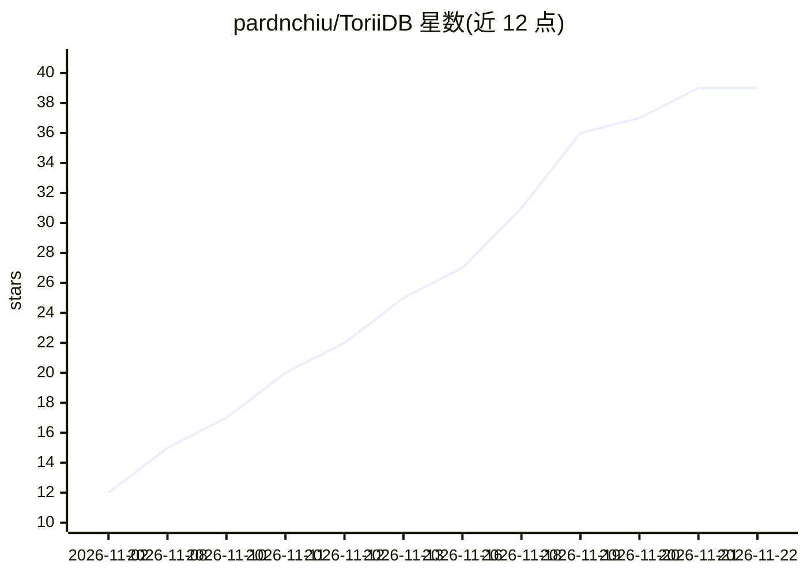

# pardnchiu/ToriiDB

⭐ 39 · Go · MIT · 推送 2026-10-06 · [GitHub](https://github.com/pardnchiu/ToriiDB) · [官网](https://toriidb.pardn.io) · 个人维护 · 中文 README

**Go 嵌入式 JSON KV 数据库，带向量搜索与 Redis 风格命令**

用 Go 编写的嵌入式键值数据库：数据以 JSON 文档存储，首个进程通过 daemon.New 成为 unix socket 守护进程，后续调用者作为客户端共享同一数据目录。写入经 fsync 追加日志持久化，压缩时原子切换快照并保留上一代用于回放。支持点号路径的嵌套字段增删改与 AND/OR/NOT 过滤、16 个隔离数据库上的 17 条 Redis 风格命令与 TTL，并可后台附加 OpenAI 向量嵌入，按余弦相似度结合 glob 过滤排序键。以 Go 库形式经 go get 安装。

## 筛选速览

| 维度 | 判定 | 备注 |
|---|---|---|
| AI 角色 | `ai-enhanced` | 去掉 AI 部分产品仍成立 |
| 许可风险 | `permissive` | MIT |
| 部署形态 | `None` |  |
| 模型依赖 | — | README 未给出锁定关系 |
| 硬件要求 | — | 无带数字的原话,不猜 |
| 安装摩擦 | `low` | 无编译、无系统依赖或容器化 |
| 成熟度 | — | 结构信号不足 |

## 能力要点

- 每目录一守护进程：后续进程自动作为客户端复用 Get/Set/Del
- fsync 追加日志与原子快照压缩，保留上一代快照回放
- JSON 嵌套字段变更与 AND/OR/NOT 查询表达式
- 后台附加 OpenAI 嵌入，余弦相似度 + glob 过滤的向量检索

## 适用场景

- Go 应用内嵌一个无需独立部署的持久化 KV/JSON 文档存储
- 多进程共享同一数据目录的本地存储场景
- 在键值数据上叠加语义向量检索

## 场景标签

`向量数据库` · 领域:知识与检索

## 证据(README 行号)

> L6:  EMBEDDED JSON KV STORAGE WITH A SHARED SOCKET DAEMON AND VECTOR SEARCH
> L23: - **Built-In Vector Search** — Attach OpenAI embeddings in the background, reuse cached vectors, and rank keys by c

## 星数曲线

2026-11-02 12 → 2026-11-22 39（+27）

---
*卡片 v1 · prompt 1.4 · 生成 2026-11-18 · 置信度 high · 依据 README sha `73489456def2` · [字段定义](../../DATASET.md)*
