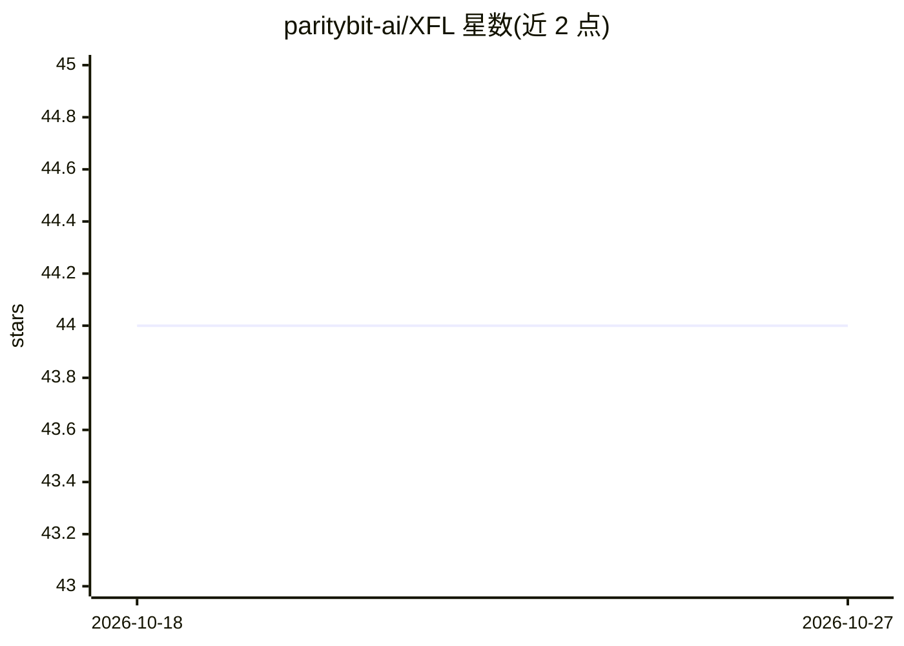

# paritybit-ai/XFL

⭐ 44 · Python · Apache-2.0 · 推送 2026-03-17 · [GitHub](https://github.com/paritybit-ai/XFL) · 组织维护 · 中文 README

**横向/纵向联邦学习训练框架，面向数据协作场景**

XFL 是一个联邦学习框架，支持横向与纵向联邦场景下的两方/多方联合建模。为在合法合规前提下共同训练模型，框架采用同态加密、差分隐私、安全多方计算等技术保护本地数据，并使用安全通信协议。部署上支持 CPU/GPU/混合部署、Docker 与 Conda 环境，任意参与方可担任任务调度器；支持 PyTorch、TensorFlow、PaddlePaddle、Jax 等主流机器学习框架，并列出对大语言模型的支持（如 Federated ChatGLM 算法条目）。安装方式为 Conda 创建 Python 3.9.7 虚拟环境后运行，采用 Apache License 2.0。README 中性能对比表述为自我声明，未附实验细节。

## 筛选速览

| 维度 | 判定 | 备注 |
|---|---|---|
| AI 角色 | `ai-ecosystem` | LLM/agent 周边工具 |
| 许可风险 | `permissive` | Apache-2.0 |
| 部署形态 | `None` |  |
| 模型依赖 | — | README 未给出锁定关系 |
| 硬件要求 | — | 无带数字的原话,不猜 |
| 安装摩擦 | `low` | 无编译、无系统依赖或容器化 |
| 成熟度 | — | 结构信号不足 |

## 能力要点

- 支持横向/纵向多种联邦算法与两方/多方联邦学习
- 采用同态加密、差分隐私、安全多方计算保护本地数据
- 支持 PyTorch/TensorFlow/PaddlePaddle/Jax 等主流框架
- 支持 CPU/GPU/混合部署，Docker 与 Conda 环境均可运行

## 适用场景

- 多方在不共享原始数据的前提下联合训练模型
- 需要密码学与差分隐私保障的合规数据协作场景
- 在 Docker 或 Conda 环境中运行联邦学习任务

## 场景标签

`模型训练` · 领域:训练与推理

## 证据(README 行号)

> L6: XFL is a high-performance, high-flexibility, high-applicability, lightweight, open and easy-to-use Federated Learnin
> L29:  - Open: support mainstream machine learning frameworks such as PyTorch、TensorFlow、PaddlePaddle and Jax, and user c

## 星数曲线

2026-10-18 44 → 2026-10-27 44（+0）

---
*卡片 v1 · prompt 1.4 · 生成 2026-10-25 · 置信度 mid · 依据 README sha `24e4e6c379e6` · [字段定义](../../DATASET.md)*
