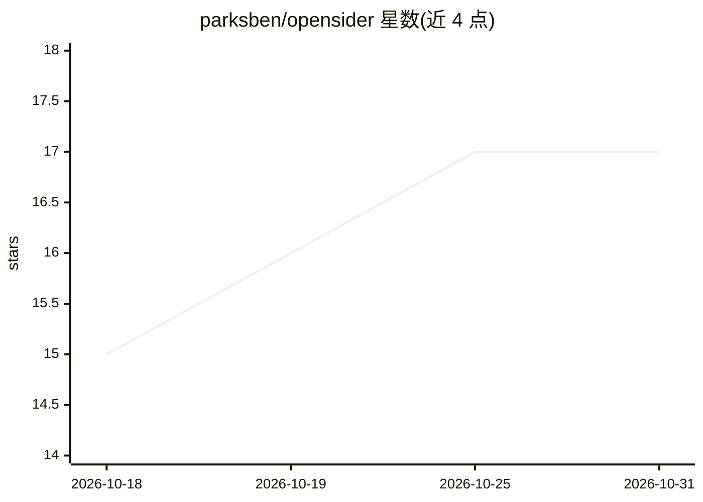

# parksben/opensider

⭐ 17 · TypeScript · MIT · 推送 2026-10-30 · [GitHub](https://github.com/parksben/opensider) · 个人维护 · 中文 README

**驱动本地 Agent CLI 操作网页的浏览器侧边栏扩展**

面向 Chromium 浏览器的侧边栏扩展，通过本地桥接进程以 ACP 协议启动并控制本机的 Agent CLI（Claude Code、Codex、OpenCode、Cursor 等），把当前标签页的导航、读取、点击、填表与截图注入为 Agent 工具，实现网页信息采集与自动化；复用浏览器已有的登录与表单状态，数据全部保存在本机 ~/.opensider，不上传服务器。安装、更新、卸载均通过向已有 Agent 发送一段提示词、按 SKILL.md 流程完成。仅支持具备 ACP 入口或适配器的 CLI，不支持桌面 Agent 应用。

## 筛选速览

| 维度 | 判定 | 备注 |
|---|---|---|
| AI 角色 | `ai-ecosystem` | LLM/agent 周边工具 |
| 许可风险 | `permissive` | MIT |
| 部署形态 | `None` |  |
| 模型依赖 | — | README 未给出锁定关系 |
| 硬件要求 | — | 无带数字的原话,不猜 |
| 安装摩擦 | `low` | 无编译、无系统依赖或容器化 |
| 成熟度 | — | 结构信号不足 |

## 能力要点

- 以 ACP 协议驱动本地 Agent CLI（Claude Code、Codex、OpenCode、Cursor 等）
- 将页面导航、点击、填表、截图注入为 Agent 工具，实时可见执行
- 复用浏览器已登录会话与已填写表单状态，无需重建场景
- 全部会话与产物存储于本地 ~/.opensider，不上传任何数据

## 适用场景

- 让本地 Agent 直接在我正看的页面上做信息采集和自动操作
- 选中网页文本进行引用、翻译或搜索
- 指定页面上的某个元素向 Agent 提问

## 场景标签

`浏览器自动化` · 领域:效率与自动化

## 证据(README 行号)

> L10: OpenSider drives the local Agent CLIs you already use — Claude Code, Codex, OpenCode, Cursor and other ACP agents —
> L93: OpenSider is itself an Agent client: its local bridge starts an Agent process and uses ACP to carry sessions, strea
> L95: Desktop apps such as Claude and Codex keep their runtime behind their own UI and do not expose a stable ACP process

## 星数曲线

2026-10-18 15 → 2026-10-31 17（+2）

---
*卡片 v1 · prompt 1.4 · 生成 2026-10-29 · 置信度 high · 依据 README sha `89c53955f03e` · [字段定义](../../DATASET.md)*
