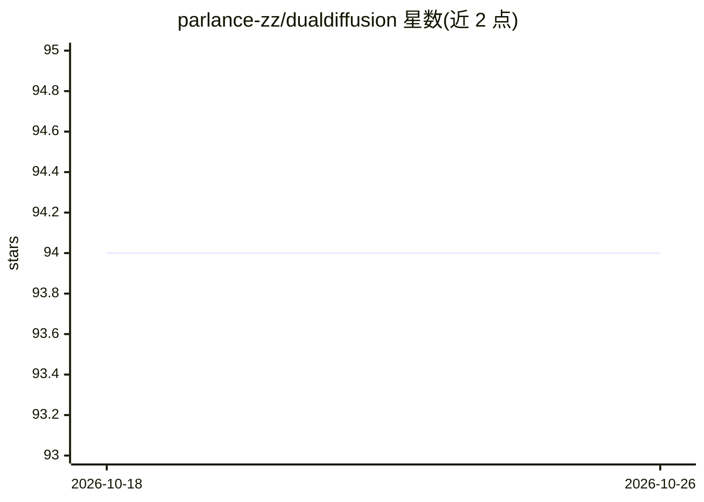

# parlance-zz/dualdiffusion

⭐ 94 · Python · MIT · 推送 2026-10-23 · [GitHub](https://github.com/parlance-zz/dualdiffusion) · [官网](https://www.g-diffuser.com/dualdiffusion/) · 个人维护

**基于扩散模型的电子游戏配乐音乐生成模型**

个人开发的音乐生成潜在扩散模型，基于 EDM2 UNet 架构与自定义两级 VAE（含扩散解码器），使用 CLAP 音频嵌入做条件控制，训练数据为 90 年代中期至今的电子游戏配乐。README 以开发日志形式记录 2023-2024 年的架构演进：从原始音频无条件生成迁移到 45 秒 @32kHz 立体声的潜在扩散，支持 inpainting/outpainting、无缝循环生成，并提供基于 NiceGUI 的 webUI。作者声明项目仍在开发中，训练与推理仅使用桌面 GPU 硬件。

## 筛选速览

| 维度 | 判定 | 备注 |
|---|---|---|
| AI 角色 | `ai-native` | 本体是模型或模型工具 |
| 许可风险 | `permissive` | MIT |
| 部署形态 | `None` |  |
| 模型依赖 | — | README 未给出锁定关系 |
| 硬件要求 | — | 无带数字的原话,不猜 |
| 安装摩擦 | `low` | 无编译、无系统依赖或容器化 |
| 成熟度 | `idea` | |

## 能力要点

- EDM2 UNet + 自定义两级 VAE（含扩散解码器）架构
- CLAP 音频嵌入条件控制与 classifier-free guidance
- 支持 inpainting/outpainting 与无缝循环生成
- 基于 NiceGUI 的 webUI，含频谱视图与时间光标

## 适用场景

- 生成电子游戏风格的背景音乐
- 对已有音频做局部重绘或向外扩展
- 生成可无缝循环的音乐片段

## 场景标签

 · 领域:生成式 AI/音乐合成

## 证据(README 行号)

> L2: Dual Diffusion is a generative diffusion model for music. This model and the code in this repository is still a work
> L4: The current model uses a custom architecture based on the EDM2 UNet and a custom 2-stage VAE design with a diffusion

## 星数曲线

2026-10-18 94 → 2026-10-26 94（+0）

---
*卡片 v1 · prompt 1.4 · 生成 2026-10-23 · 置信度 high · 依据 README sha `ebb2ce088700` · [字段定义](../../DATASET.md)*
