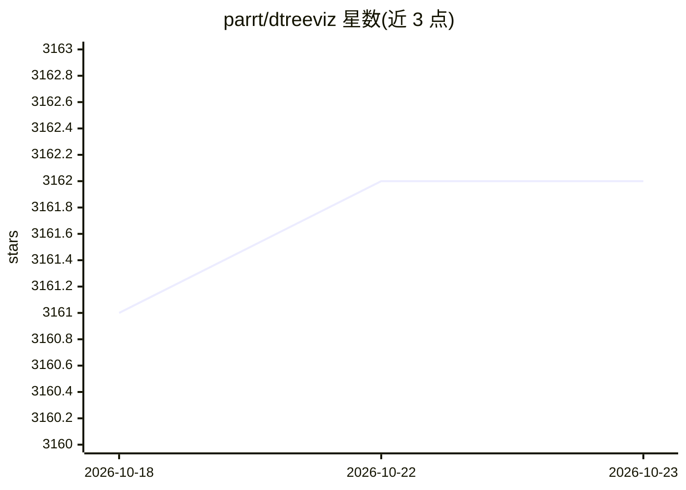

# parrt/dtreeviz

⭐ 3,162 · Jupyter Notebook · MIT · 推送 2026-01-02 · [GitHub](https://github.com/parrt/dtreeviz) · 个人维护

**决策树可视化与模型解释的 Python 库**

面向使用 scikit-learn、XGBoost、Spark MLlib、LightGBM、TensorFlow 训练决策树的开发者与学习者，提供树结构可视化、预测路径解释、叶子节点信息、特征空间探索与分类决策边界绘制。通过 dtreeviz.model() 适配器抽取模型信息，各库共用同一编程接口。可选启用 AI 聊天功能（pip install dtreeviz[ai] 且设置 OPENAI_API_KEY），对树结构提问并在可视化旁生成 LLM 解释。当前仅能生成 SVG 输出，依赖系统级 graphviz（dot）。

## 筛选速览

| 维度 | 判定 | 备注 |
|---|---|---|
| AI 角色 | `ai-ecosystem` | LLM/agent 周边工具 |
| 许可风险 | `permissive` | MIT |
| 部署形态 | `desktop` | 安装包/桌面程序 |
| 模型依赖 | — | README 未给出锁定关系 |
| 硬件要求 | — | 无带数字的原话,不猜 |
| 安装摩擦 | `medium` | 含编译或系统依赖之一 |
| 成熟度 | — | 结构信号不足 |

## 能力要点

- 支持 scikit-learn/XGBoost/Spark MLlib/LightGBM/TensorFlow 五种库的统一适配器接口
- 树可视化、预测路径解释、叶子信息与特征空间探索
- decision_boundaries() 可用于任意实现 predict_proba() 的模型
- 可选 AI 聊天：基于树结构知识回答问题并生成 LLM 解释

## 适用场景

- 训练完决策树或随机森林后可视化树结构与分裂路径
- 解释单个样本的预测路径与叶子统计
- 在 notebook 中交互式提问了解模型结构与训练数据特征

## 场景标签

 · 领域:机器学习/数据科学

## 证据(README 行号)

> L5: A python library for decision tree visualization and model interpretation. Decision trees are the fundamental buildi
> L7: Currently dtreeviz supports: scikit-learn, XGBoost, Spark MLlib, LightGBM, and Tensorflow. See Installation instruct

## 星数曲线

2026-10-18 3,161 → 2026-10-23 3,162（+1）

---
*卡片 v1 · prompt 1.4 · 生成 2026-10-20 · 置信度 high · 依据 README sha `ca2c63f658a0` · [字段定义](../../DATASET.md)*
