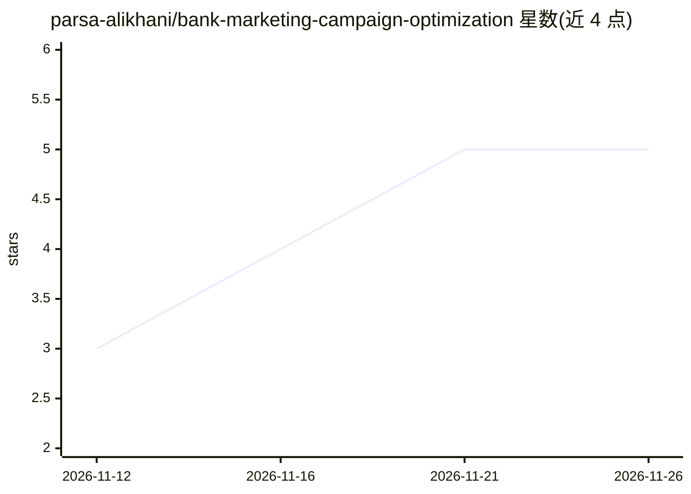

# parsa-alikhani/bank-marketing-campaign-optimization

⭐ 5 · Jupyter Notebook · 推送 2026-11-09 · [GitHub](https://github.com/parsa-alikhani/bank-marketing-campaign-optimization) · 个人维护

**银行定期存款营销的成本敏感建模与阈值调优分析笔记本**

基于葡萄牙银行 45,211 条历史营销记录的分析项目，全部代码与结果收录于单个 Jupyter 笔记本。按时间顺序划分训练/验证/最终期，从 8 个预声明模型中按损失函数（5 FP + 25 FN）选择逻辑回归（C=0.1）与约 0.09658 的概率阈值，并与全量外呼、简单业务规则等基线在最终期比较成本。面向数据分析与机器学习从业者。笔记本保存了计算结果，可在 GitHub 上直接阅读，也可在 Python 3.11/3.12 环境复跑。

## 筛选速览

| 维度 | 判定 | 备注 |
|---|---|---|
| AI 角色 | `ai-native` | 本体是模型或模型工具 |
| 许可风险 | `permissive` | — |
| 部署形态 | `library` | 以包/库形式分发 |
| 模型依赖 | — | README 未给出锁定关系 |
| 硬件要求 | — | 无带数字的原话,不猜 |
| 安装摩擦 | `low` | 无编译、无系统依赖或容器化 |
| 成熟度 | — | 结构信号不足 |

## 能力要点

- 按业务损失 5 FP + 25 FN 做模型与概率阈值选择，含平局规则
- 时间顺序 60/20/20 评估，检验后期分布漂移下的策略稳定性
- 比较全量外呼、上一期成功规则等简单基线策略
- 含成本比敏感性、容量预算、置换重要性与移动块 bootstrap 不确定性分析

## 适用场景

- 营销外呼场景中按业务成本设定分类阈值
- 学习时间划分评估与成本敏感学习的完整分析流程
- 评估简单业务规则与模型策略的成本差异

## 场景标签

`数据分析` · 领域:效率与自动化

## 证据(README 行号)

> L5: This project evaluates term-deposit marketing decisions using 45,211 historical records from a Portuguese banking in
> L41: - Exact model/threshold selection using `5 FP + 25 FN`, with explicit tie rules and comparison against an F1-select

## 星数曲线

2026-11-12 3 → 2026-11-26 5（+2）

---
*卡片 v1 · prompt 1.4 · 生成 2026-11-21 · 置信度 high · 依据 README sha `c502835d82af` · [字段定义](../../DATASET.md)*
