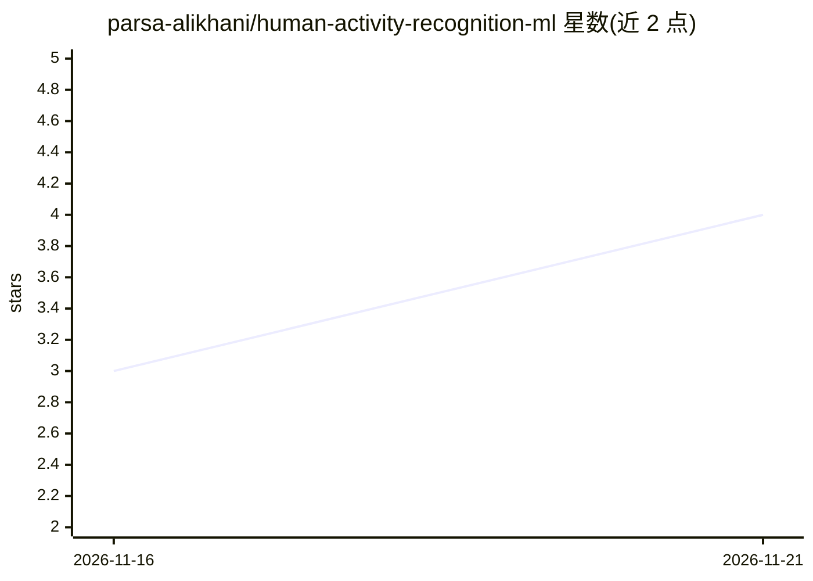

# parsa-alikhani/human-activity-recognition-ml

⭐ 4 · Jupyter Notebook · NOASSERTION · 推送 2026-11-10 · [GitHub](https://github.com/parsa-alikhani/human-activity-recognition-ml) · 个人维护

**面向研究者的人物感知活动识别评估案例研究**

基于 UCI HAR 公开数据集（561 个已发布特征、30 人）的离线研究项目：以 subject-aware 方式做模型选择，涵盖嵌套稳定性验证、PCA/LDA 降维、24 种 KNN 设置及线性模型，共 32 个候选配置；另设随机行切分审计以对比身份泄漏的影响，并输出逐人误差与逐活动误差分析。提供已执行的 notebook、可复现实验脚本、pytest 测试与推理 CLI，MIT 许可。

## 筛选速览

| 维度 | 判定 | 备注 |
|---|---|---|
| AI 角色 | `ai-native` | 本体是模型或模型工具 |
| 许可风险 | `none` | NOASSERTION |
| 部署形态 | `library` | 以包/库形式分发 |
| 模型依赖 | — | README 未给出锁定关系 |
| 硬件要求 | — | 无带数字的原话,不猜 |
| 安装摩擦 | `low` | 无编译、无系统依赖或容器化 |
| 成熟度 | — | 结构信号不足 |

## 能力要点

- subject-aware 切分：所有人层级（选择、验证、测试）按被试分离
- 嵌套稳定性研究：五个外层切分评估选择流程本身
- 32 个候选配置（Full/PCA/LDA × 距离 × k，加线性模型）与固定基准对比
- 随机行审计量化同被试泄漏导致的分数差异

## 适用场景

- 研究智能手机活动识别模型在新用户上的泛化
- 学习 subject-aware 模型选择与嵌套验证流程
- 复现带哈希校验与固定种子的实验研究

## 场景标签

`模型评测` `科研工具` · 领域:评测与运维

## 证据(README 行号)

> L3: **Can a smartphone activity classifier recognize a new user?** This case study
> L7: The project uses Python, pandas and scikit-learn on the 561 published UCI HAR
> L106: The primary metric is Macro-F1 over labels 1–6 (`zero_division=0`), accompanied by

## 星数曲线

2026-11-16 3 → 2026-11-21 4（+1）

---
*卡片 v1 · prompt 1.4 · 生成 2026-11-21 · 置信度 high · 依据 README sha `edc61c25caf9` · [字段定义](../../DATASET.md)*
