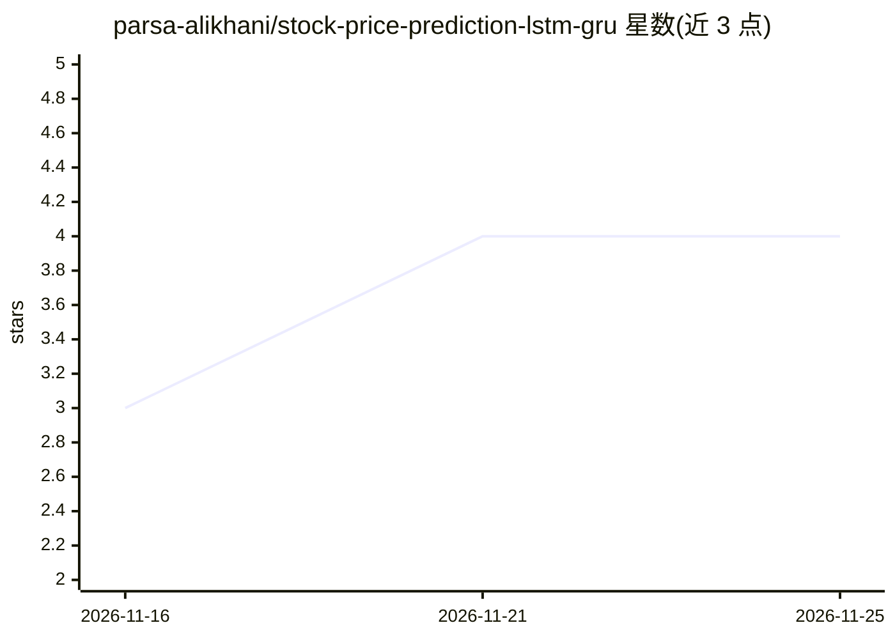

# parsa-alikhani/stock-price-prediction-lstm-gru

⭐ 4 · Jupyter Notebook · 推送 2026-11-08 · [GitHub](https://github.com/parsa-alikhani/stock-price-prediction-lstm-gru) · 个人维护

**对比 LSTM 与 GRU 预测五只科技股股价的 Jupyter 项目**

一个深度学习笔记本项目：用 yfinance 下载五只科技股（AAPL/MSFT/GOOGL/AMZN/NVDA）的历史行情，对调整后收盘价与五周期均线两个目标分别训练 LSTM 和 GRU 模型（60 步输入预测下一步），共 20 次拟合，以 RMSE 评估并给出两种架构的对比结果。README 附带保存的实验输出，声明依赖未固定、数据下载导致复现结果可能不同，并指出 MinMaxScaler 存在数据泄漏风险、未含朴素基准与交易盈利性评估。

## 筛选速览

| 维度 | 判定 | 备注 |
|---|---|---|
| AI 角色 | `ai-native` | 本体是模型或模型工具 |
| 许可风险 | `none` | — |
| 部署形态 | `None` |  |
| 模型依赖 | — | README 未给出锁定关系 |
| 硬件要求 | — | 无带数字的原话,不猜 |
| 安装摩擦 | `low` | 无编译、无系统依赖或容器化 |
| 成熟度 | — | 结构信号不足 |

## 能力要点

- 五只股票 × 两种架构 × 两个目标共 20 次模型拟合
- 统一配置：2 层循环单元（各 50 units）、Dropout 0.2、Adam、20 epochs
- 以 RMSE 对比 LSTM 与 GRU 并逐股报告结果
- 自带 exploratory 可视化：收盘价、成交量、日收益、均线与相关性

## 适用场景

- 学习 LSTM/GRU 时间序列预测的完整流程
- 复用或改写笔记本跑其他股票的一步预测实验
- 参考两种循环网络在不同目标上的 RMSE 对比

## 场景标签

`教程课程` `金融量化` · 领域:学习与行业

## 证据(README 行号)

> L3: A deep learning project combining historical stock-price trend analysis with a comparison of **LSTM** and **GRU** ne
> L25: For each stock, the notebook trains separate LSTM and GRU models on two targets:

## 星数曲线

2026-11-16 3 → 2026-11-25 4（+1）

---
*卡片 v1 · prompt 1.4 · 生成 2026-11-21 · 置信度 high · 依据 README sha `77c1e3e6a9f2` · [字段定义](../../DATASET.md)*
