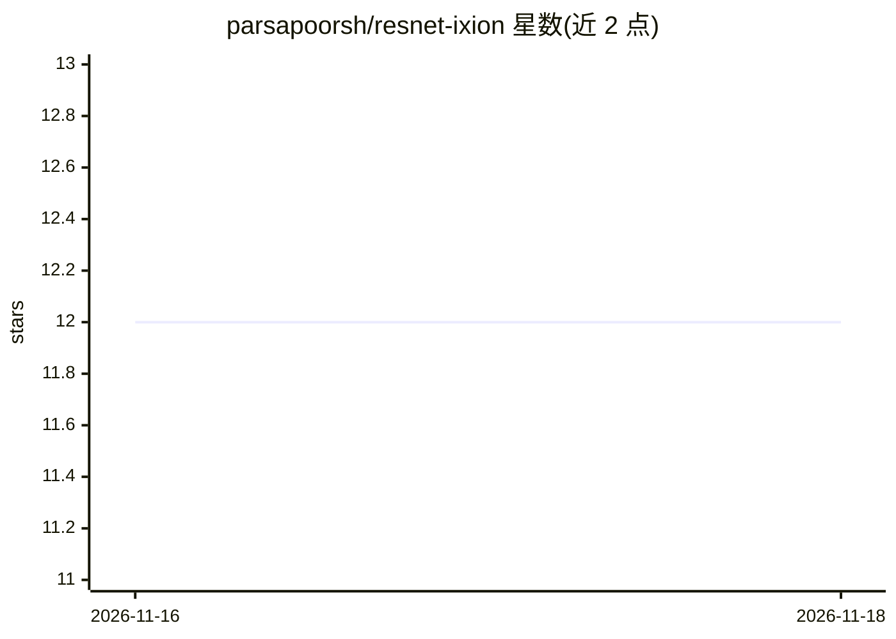

# parsapoorsh/resnet-ixion

⭐ 12 · Python · Apache-2.0 · 推送 2026-11-16 · [GitHub](https://github.com/parsapoorsh/resnet-ixion) · 个人维护

**基于 ResNet 微调的图片方向分类模型（4 类旋转角）**

该项目提供一个以 resnet152 为基础微调而来的图像方向分类模型，将图片判定为 0°/90°/180°/270° 四个旋转类别之一。训练数据来自 MS COCO 的 train2017/test2017/val2017 划分，作者使用单张 NVIDIA GTX 1660 SUPER（6 GiB VRAM）GPU 训练，每轮约耗时 3 小时 45 分钟。模型可从 GitHub Releases 下载或在 Google Colab 中试用，许可证为 apache-2.0。README 声明该项目为遗留版本，已被 ixion 仓库取代。

## 筛选速览

| 维度 | 判定 | 备注 |
|---|---|---|
| AI 角色 | `ai-native` | 本体是模型或模型工具 |
| 许可风险 | `permissive` | Apache-2.0 |
| 部署形态 | `None` |  |
| 模型依赖 | — | README 未给出锁定关系 |
| 硬件要求 | — | 无带数字的原话,不猜 |
| 安装摩擦 | `low` | 无编译、无系统依赖或容器化 |
| 成熟度 | — | 结构信号不足 |

## 能力要点

- 基于 resnet152 微调的 4 类方向分类模型（0°/90°/180°/270°）
- 使用 MS COCO 数据集进行微调训练
- 提供 Google Colab 试用与 GitHub Releases 模型下载

## 适用场景

- 对图片库中的照片做旋转方向自动归类
- 在图像处理流水线中预处理纠正图片朝向

## 场景标签

`目标检测` · 领域:感知与多模态

## 证据(README 行号)

> L3: ## Image Orientation Detection Using ResNet
> L10: this model is a fine-tuned variant of resnet152.
> L12: it's been converted to a classfication model with 4 classes. `0°, 90°, 180°, 270°`.

## 星数曲线

2026-11-16 12 → 2026-11-18 12（+0）

---
*卡片 v1 · prompt 1.4 · 生成 2026-11-18 · 置信度 high · 依据 README sha `be8b2697f88c` · [字段定义](../../DATASET.md)*
