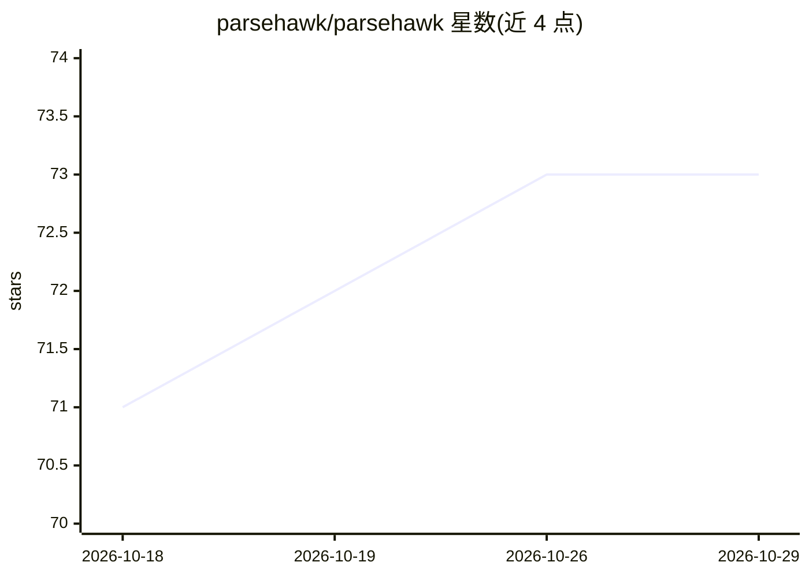

# parsehawk/parsehawk

⭐ 73 · Python · Apache-2.0 · 推送 2026-10-20 · [GitHub](https://github.com/parsehawk/parsehawk) · [官网](https://docs.parsehawk.com/) · 组织维护

**本地优先的文档 AI：将 PDF/图像转为 Markdown 或校验后的 JSON**

文档解析与结构化抽取工具：把 PDF、扫描件、图像、文本转为页级 Markdown，或按 JSON Schema Draft 2020-12 契约输出校验后的 JSON，支持零样本指令与少样本示例。默认以 vLLM 在 Linux NVIDIA 或 macOS Apple Silicon 上完全本地运行，也可切换 Ollama、OpenAI 等 OpenAI 兼容后端。提供 Web UI、CLI 与 OpenAPI 3.1 REST API 三种接口，本地 SQLite 状态与 Phoenix 追踪。不支持 Windows 和 Intel Mac 的内置运行时。由 Totoy GmbH 开发，处于 1.0 以下开发者预览阶段。

## 筛选速览

| 维度 | 判定 | 备注 |
|---|---|---|
| AI 角色 | `ai-native` | 本体是模型或模型工具 |
| 许可风险 | `permissive` | Apache-2.0 |
| 部署形态 | `None` |  |
| 模型依赖 | local-ok | 支持本地模型 |
| 硬件要求 | `gpu-8g` | |
| 安装摩擦 | `medium` | 含编译或系统依赖之一 |
| 成熟度 | `idea` | |

## 能力要点

- PDF/扫描/图像/文本到 JSON Schema 校验 JSON 的抽取，异步任务记录
- 默认 100% 本地运行（NuExtract3 + vLLM），可按解析器/抽取器选择后端
- Web UI、CLI 与 OpenAPI 3.1 REST API 共享同一资源模型
- macOS Apple Silicon 与 Linux NVIDIA 双平台支持，含 uv 安装与 parsehawk doctor 诊断

## 适用场景

- 把私有 PDF/扫描件批量转为符合自定义 Schema 的 JSON
- 在本地跑通文档转 Markdown 工作流，数据不出机器
- 通过 REST API 把文档抽取接入自己的流水线

## 场景标签

`文档解析` · 领域:知识与检索

## 证据(README 行号)

> L21: ParseHawk parses PDFs and images into page-aware Markdown, and turns PDFs,
> L27: The default setup runs locally with NuExtract3 through vLLM on Linux NVIDIA or

## 星数曲线

2026-10-18 71 → 2026-10-29 73（+2）

---
*卡片 v1 · prompt 1.4 · 生成 2026-10-24 · 置信度 high · 依据 README sha `2b5540e83252` · [字段定义](../../DATASET.md)*
