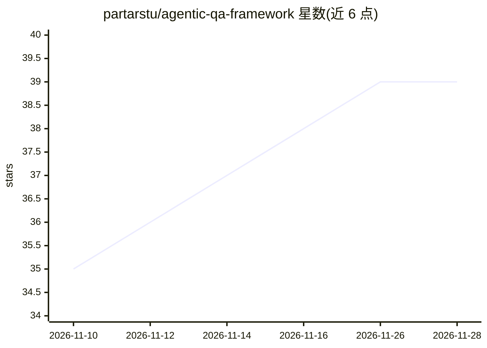

# partarstu/agentic-qa-framework

⭐ 39 · Python · AGPL-3.0 · 推送 2026-11-22 · [GitHub](https://github.com/partarstu/agentic-qa-framework) · 组织维护

**AI 多智能体软件测试自动化框架：从需求评审到测试报告**

开源多智能体框架 QuAIA™，覆盖软件测试生命周期：需求评审、测试用例设计（生成-评审-修复-发布循环，含重复检测与严重度分级）、事件报告创建与 Allure 测试报告。中央编排器按 A2A/MCP 协议路由任务至专职智能体；集成 Jira/Confluence RAG 同步（Qdrant 向量库）、EmbeddingGemma 2 嵌入服务、ProtectAI 提示注入检测微服务、Web 监控面板与 JWT 认证。面向质量工程/测试团队与开发者。

## 筛选速览

| 维度 | 判定 | 备注 |
|---|---|---|
| AI 角色 | `ai-native` | 本体是模型或模型工具 |
| 许可风险 | `viral` | AGPL-3.0 |
| 部署形态 | `self-host` | docker 或自建部署 |
| 模型依赖 | — | README 未给出锁定关系 |
| 硬件要求 | — | 无带数字的原话,不猜 |
| 安装摩擦 | `low` | 无编译、无系统依赖或容器化 |
| 成熟度 | — | 结构信号不足 |

## 能力要点

- 测试用例设计智能体：生成-评审-修复-发布循环，含覆盖缺口与重复覆盖检查
- A2A 与 MCP 协议兼容的编排层与专职智能体架构
- Jira/Confluence RAG 同步到 Qdrant，含变更检测与附件离线 OCR
- 提示注入检测微服务与实时 Web 监控面板

## 适用场景

- 自动评审用户故事需求并生成、修复、发布测试用例
- 将 Jira/Confluence 项目知识同步进向量库供智能体检索
- 实时监控多智能体状态、任务历史与执行日志

## 场景标签

`多智能体` · 领域:Agent 开发

## 证据(README 行号)

> L5: QuAIA™ is an open-source framework for intelligent automation of the most important software testing life cycle
> L21:  * Test Case Design: generates the test cases of a user story, reviews and fixes them in a loop, then saves, classi
> L42: * **A2A and MCP - compliant:** Adheres to the specifications of Agent2Agent and Model Context protocols.

## 星数曲线

2026-11-10 35 → 2026-11-28 39（+4）

---
*卡片 v1 · prompt 1.4 · 生成 2026-11-18 · 置信度 mid · 依据 README sha `3375d0c672e8` · [字段定义](../../DATASET.md)*
