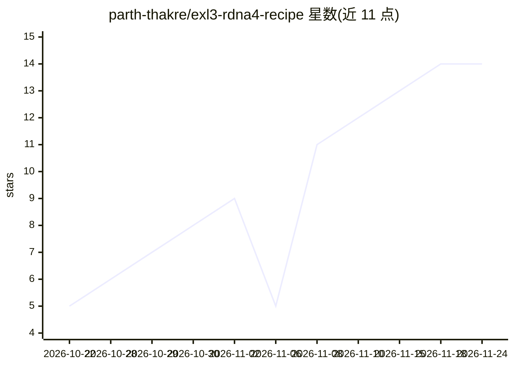

# parth-thakre/exl3-rdna4-recipe

⭐ 14 · Shell · NOASSERTION · 推送 2026-11-17 · [GitHub](https://github.com/parth-thakre/exl3-rdna4-recipe) · 个人维护

**在 AMD RX 9070 XT 上本地运行 Qwen3.8-27B 的配置方案**

面向 AMD RDNA4 显卡（RX 9070 XT/9070，gfx1201）用户的 Qwen3.8-27B EXL3 3.0bpw 量化本地部署方案：基于上游 ExLlamaV3 与 TabbyAPI，叠加 RDNA4 补丁（WMMA GEMV 投机解码验证、批量化验证、4-bit cache 等），配合 DFlash2 draft 模型做投机解码，以 OpenAI 兼容 API 服务形式提供（96k 上下文默认、128k 可选，支持工具调用与图像输入）。提供容器一行安装（Docker/Podman）或宿主机脚本安装两种方式；仅测试过一张 9070 XT，宿主机安装需要 ROCm HIP SDK 并编译，Windows 未测试。

## 筛选速览

| 维度 | 判定 | 备注 |
|---|---|---|
| AI 角色 | `ai-ecosystem` | LLM/agent 周边工具 |
| 许可风险 | `none` | NOASSERTION |
| 部署形态 | `self-host` | docker 或自建部署 |
| 模型依赖 | — | README 未给出锁定关系 |
| 硬件要求 | — | 无带数字的原话,不猜 |
| 安装摩擦 | `low` | 无编译、无系统依赖或容器化 |
| 成熟度 | — | 结构信号不足 |

## 能力要点

- RDNA4 补丁：WMMA GEMV 将 8 token 草稿验证开销从 1.55x 降至 1.16x
- DFlash2 draft 投机解码，3.0bpw draft 仅 0.9 GB
- 默认 96k 上下文（可选 128k/160k），代码任务约 150 tok/s
- 容器一行安装（任意 Linux 发行版）或宿主机脚本安装

## 适用场景

- 在 AMD RX 9070 XT 上跑本地 OpenAI 兼容推理服务供编码 agent 使用
- 16GB 显存内运行 27B 模型并保留长上下文
- 用投机解码在 RDNA4 上提升本地推理速度

## 场景标签

`模型量化` `推理引擎` · 领域:训练与推理

## 证据(README 行号)

> L3: Run Qwen3.8-27B (EXL3, 3.0 bpw: turboderp's self-calibrated `SC_3.00bpw_H4` quant) on an AMD RX 9070 XT or RX 9070
> L4: under Linux as a local OpenAI-compatible server for coding agents and chat. It uses upstream ExLlamaV3 and
> L23: - **Setup:** one line to install and run (a container, any distro, Omarchy included), or a handful of scripts for a

## 星数曲线

2026-10-22 5 → 2026-11-24 14（+9）

---
*卡片 v1 · prompt 1.4 · 生成 2026-11-18 · 置信度 high · 依据 README sha `ae8062db49d4` · [字段定义](../../DATASET.md)*
