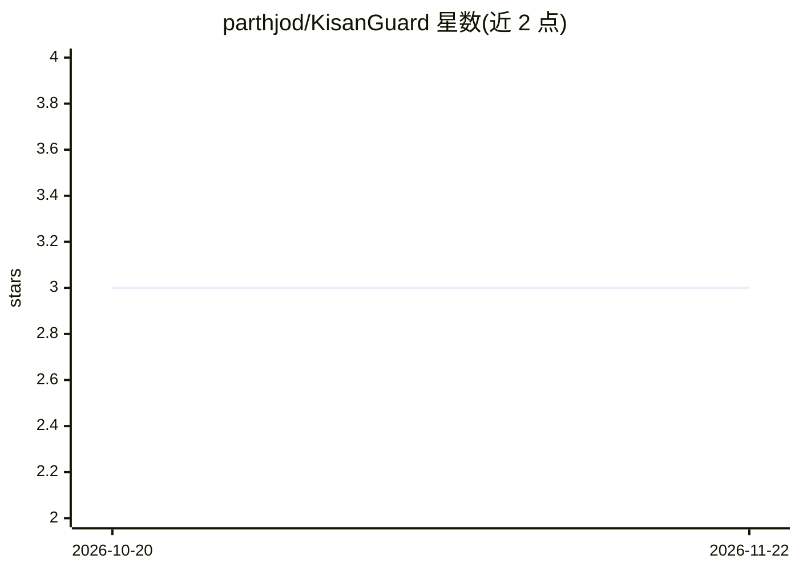

# parthjod/KisanGuard

⭐ 3 · TypeScript · 推送 2026-10-11 · [GitHub](https://github.com/parthjod/KisanGuard) · [官网](https://d2wnlort4mta2e.cloudfront.net) · 个人维护

**面向印度小农户的村域级高温与干旱情报预警平台**

为印度 1.5 亿小农户提供 1km² 村级精度的 WBGT 高温预报、作物干旱指数与 14 天产量风险预测，并生成 6 种语言的个性化语音农事建议。包含 3 个自训练 ML 模型（XGBoost+LSTM、校准分类器+回归器、PPO 强化学习灌溉策略）、Amazon A2I 人工复核信任层、不可变审计日志，通过 SMS/语音电话/WhatsApp/推送触达功能机用户。后端 FastAPI，前端 React，依赖 AWS 服务栈，可用 Docker Compose + LocalStack 本地运行。

## 筛选速览

| 维度 | 判定 | 备注 |
|---|---|---|
| AI 角色 | `ai-native` | 本体是模型或模型工具 |
| 许可风险 | `none` | — |
| 部署形态 | `self-host` | docker 或自建部署 |
| 模型依赖 | locked-api |  |
| 硬件要求 | — | 无带数字的原话,不猜 |
| 安装摩擦 | `low` | 无编译、无系统依赖或容器化 |
| 成熟度 | — | 结构信号不足 |

## 能力要点

- 3 个自训练 ML 模型：WBGT 预报、CDHI 干旱-热指数、PPO 灌溉策略
- Bedrock Llama 3 生成 6 语言农事建议，Polly Neural 语音合成
- A2I 人工复核与 4 级异常标记、SLA 与不可变审计链
- SMS/语音/WhatsApp 多通道送达，支持功能手机

## 适用场景

- 为农户提供未来 48 小时热应激预警与作息建议
- 按作物与生长阶段预测 14 天产量风险与收入损失
- 获取地块级灌溉量与灌溉时机建议
- 向无智能手机的用户发送本地语言语音预警

## 场景标签

`语音合成` `强化学习` · 领域:内容生成

## 证据(README 行号)

> L27: KisanGuard delivers **ward-level (1 km²) heat stress forecasts, crop drought intelligence, and AI-generated voice a
> L74:  🌡️ Model 1 — WBGT
> L143: - **Amazon Bedrock** (Meta Llama 3 8B Instruct) advisory generation

## 星数曲线

2026-10-20 3 → 2026-11-22 3（+0）

---
*卡片 v1 · prompt 1.4 · 生成 2026-11-21 · 置信度 mid · 依据 README sha `54f1ccb87a0b` · [字段定义](../../DATASET.md)*
