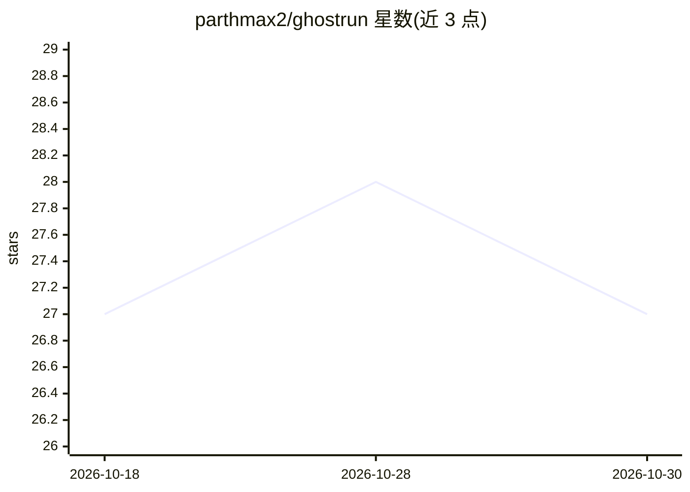

# parthmax2/ghostrun

⭐ 27 · Python · MIT · 推送 2026-08-29 · [GitHub](https://github.com/parthmax2/ghostrun) · [官网](https://ghostrun.parthmax.tech) · 个人维护

**面向 AI 应用的 pytest 测试与提示优化工具，离线免费**

为在 pytest 中测试 LLM 调用代码的 Python 开发者提供的工具库：@ghostrun.record 首次调用真实 API 后将响应存盘，后续运行从磁盘重放，实现 0.05 秒级、零成本、可离线运行的回归测试；ghostrun.expect 提供语义断言（tone_is、contains_intent 等），由本地 Ollama 小模型（如 llama3.2:3b）担任裁判以保证数据私密；ghostrun craft 按类型签名与训练示例自动搜索提示指令与 few-shot 示例以通过测试。通过 pip 安装，支持 OpenAI/Anthropic SDK 与通用 HTTP 回退的录制。另含桌面动画伴侣（ghostrun pet）等辅助功能。

## 筛选速览

| 维度 | 判定 | 备注 |
|---|---|---|
| AI 角色 | `ai-ecosystem` | LLM/agent 周边工具 |
| 许可风险 | `permissive` | MIT |
| 部署形态 | `library` | 以包/库形式分发 |
| 模型依赖 | local-ok | 支持本地模型 |
| 硬件要求 | — | 无带数字的原话,不猜 |
| 安装摩擦 | `low` | 无编译、无系统依赖或容器化 |
| 成熟度 | — | 结构信号不足 |

## 能力要点

- 录制/重放机制：首跑调 API 存盘，后续离线 0.05 秒重放
- 语义断言（tone_is/contains_intent）由本地 Ollama 裁判评分
- ghostrun craft 自动搜索提示指令与 few-shot 示例
- ghostrun init 按检测到的 LLM SDK 自动生成首个测试

## 适用场景

- 让调用 OpenAI/Anthropic 的 pytest 套件在 CI 中离线免费运行
- 捕捉提示修改引发的语义回归
- 自动优化提示指令和 few-shot 示例以通过预设测试

## 场景标签

`提示工程` `模型评测` · 领域:Agent 开发

## 证据(README 行号)

> L3:  pytest for LLMs — Write fast, zero-cost tests for your AI prompts, and optimize them automatically when they fail.
> L36: * **Fast & Free Tests (Deterministic Replay):** Wrap your test in `@ghostrun.record`. The first run hits the real A

## 星数曲线

2026-10-18 27 → 2026-10-30 27（+0）

---
*卡片 v1 · prompt 1.4 · 生成 2026-10-26 · 置信度 high · 依据 README sha `96abc5bd59c6` · [字段定义](../../DATASET.md)*
