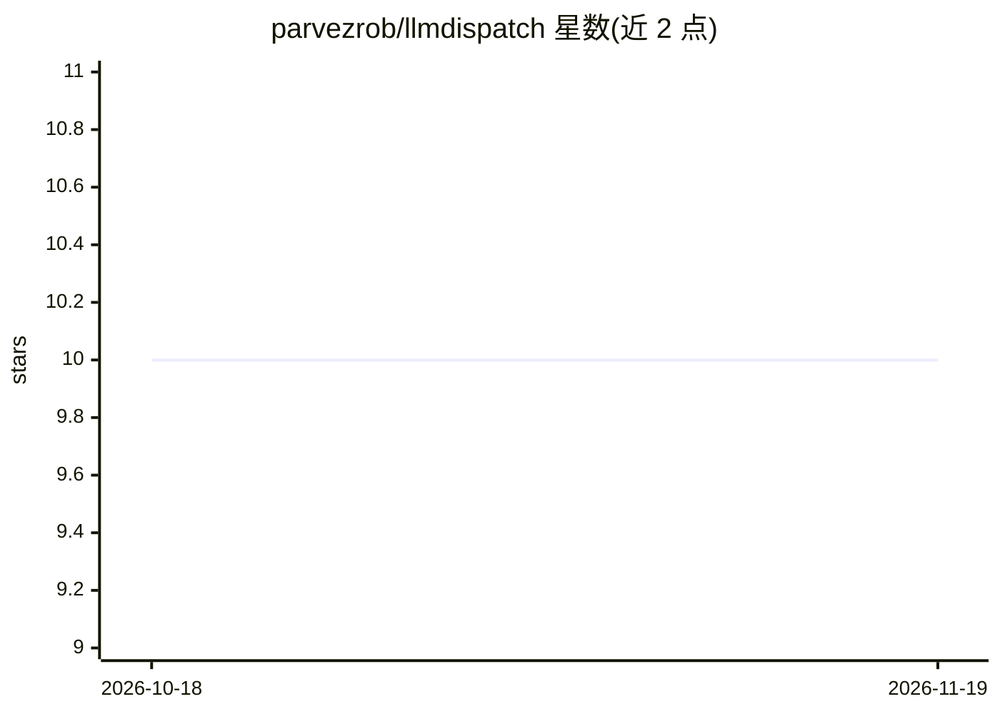

# parvezrob/llmdispatch

⭐ 10 · TypeScript · MIT · 推送 2026-11-17 · [GitHub](https://github.com/parvezrob/llmdispatch) · [官网](https://www.npmjs.com/package/llmdispatch) · 个人维护

**模型无关的 Node.js 库：按操作路由 LLM 调用并管理回退与配额**

llmdispatch 是模型无关的 Node.js 库，用于定义命名 AI 操作：用 Zod 输入输出模式加提示词定义操作，库将调用路由到指定提供商与模型，并在返回前校验响应。路由与每日每用户配额存于自身 Postgres，可在不重新部署的情况下修改；失败时可重试回退模型；API key 通过解析函数传入，库不存储。通过内置 fetch 适配器调用 Anthropic、Gemini 或任何 OpenAI 兼容 API，无托管代理，需 Node/ESM 环境。

## 筛选速览

| 维度 | 判定 | 备注 |
|---|---|---|
| AI 角色 | `ai-ecosystem` | LLM/agent 周边工具 |
| 许可风险 | `permissive` | MIT |
| 部署形态 | `library` | 以包/库形式分发 |
| 模型依赖 | locked-api |  |
| 硬件要求 | — | 无带数字的原话,不猜 |
| 安装摩擦 | `low` | 无编译、无系统依赖或容器化 |
| 成熟度 | — | 结构信号不足 |

## 能力要点

- 命名操作 + Zod 模式校验的调用封装
- 路由与每日每用户配额存于 Postgres，无部署即可改
- 失败可重试回退模型，结果报告路由、回退与成本
- 内置 fetch 适配器调用 Anthropic/Gemini/OpenAI 兼容 API，支持文本、PDF/图片输入与图像、SVG 生成

## 适用场景

- 在不重新部署的情况下切换应用内 LLM 提供商与模型
- 按用户执行每日调用配额控制
- 为关键操作配置回退模型链
- 统一管理文本、图像与 SVG 生成操作

## 场景标签

`模型网关` · 领域:Agent 开发

## 证据(README 行号)

> L3: llmdispatch is a model-agnostic Node.js library for named AI operations.
> L5: Most apps hard-code one vendor's SDK and scatter model names through the code, so changing the model means a deploy.
> L7: Define each operation with Zod input and output schemas plus a prompt. llmdispatch routes the call to a provider and

## 星数曲线

2026-10-18 10 → 2026-11-19 10（+0）

---
*卡片 v1 · prompt 1.4 · 生成 2026-11-19 · 置信度 high · 依据 README sha `e15811537b15` · [字段定义](../../DATASET.md)*
