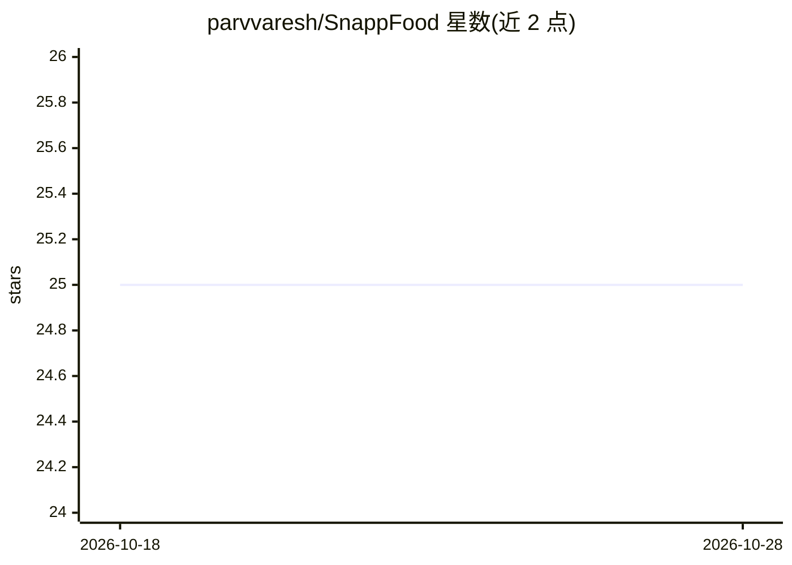

# parvvaresh/SnappFood

⭐ 25 · Python · 推送 2026-01-29 · [GitHub](https://github.com/parvvaresh/SnappFood) · [官网](https://parvvaresh.github.io/SnappFood/) · 个人维护

**波斯语评论情感分析 Flask Web 应用（经典 ML 与 LSTM 对比）**

面向 SnappFood 用户评论的波斯语情感分析 Web 应用：Flask 提供输入界面，模型将文本分类为正面或负面。包含两条路径——经典机器学习模型（NearestCentroid/SVM/逻辑回归等）配自定义波斯语预处理管线（标点去除、规范化、分词、停用词、hazm 词元化），以及 TensorFlow 内置预处理的 LSTM 模型；README 列出各模型测试准确率（LSTM 0.8439 最高）。支持本地 venv 运行与 Docker 容器部署，需 Python 3.11。

## 筛选速览

| 维度 | 判定 | 备注 |
|---|---|---|
| AI 角色 | `ai-native` | 本体是模型或模型工具 |
| 许可风险 | `none` | — |
| 部署形态 | `self-host` | docker 或自建部署 |
| 模型依赖 | — | README 未给出锁定关系 |
| 硬件要求 | — | 无带数字的原话,不猜 |
| 安装摩擦 | `low` | 无编译、无系统依赖或容器化 |
| 成熟度 | — | 结构信号不足 |

## 能力要点

- 经典 ML 模型与 LSTM 模型的波斯语情感分类对比（含测试准确率表）
- 基于 hazm 库的波斯语自定义预处理管线
- Flask Web 界面实时输入文本并返回正/负预测
- 提供 Docker 容器化部署

## 适用场景

- 在网页输入波斯语评论并即时得到情感分类
- 对比经典机器学习与 LSTM 在波斯语文本上的表现
- 以 Docker 方式部署情感分析服务

## 场景标签

 · 领域:NLP/情感分析

## 证据(README 行号)

> L3: This is a Flask-based web application for Persian sentiment analysis. The app utilizes a custom pre-processing pipel
> L9: - **Real-time Sentiment Prediction**: Users can input Persian text to receive instant sentiment predictions.

## 星数曲线

2026-10-18 25 → 2026-10-28 25（+0）

---
*卡片 v1 · prompt 1.4 · 生成 2026-10-26 · 置信度 high · 依据 README sha `04652e170e9c` · [字段定义](../../DATASET.md)*
