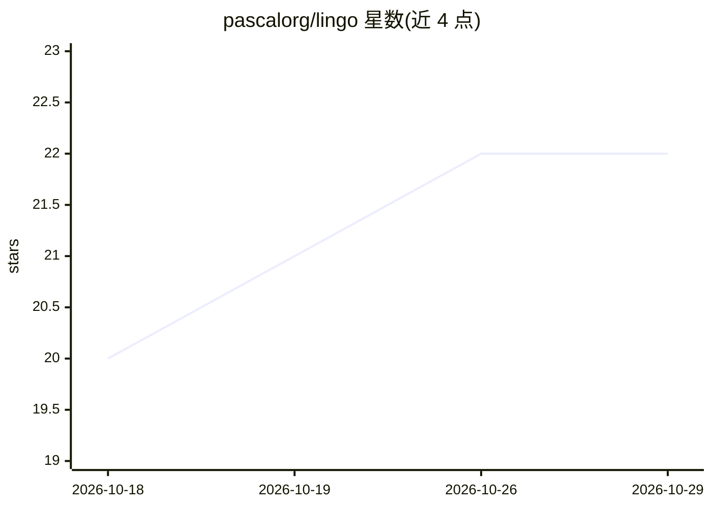

# pascalorg/lingo

⭐ 22 · TypeScript · MIT · 推送 2026-10-27 · [GitHub](https://github.com/pascalorg/lingo) · [官网](https://lingo.pascal.app) · 组织维护

**零依赖解析库：把自然语言数量/单位/日期/区间转为规范值**

TypeScript 单一解析器库，把 `180cm`、`next friday`、`5'11"` 一类松散输入解析为规范化的数值/单位/ISO 日期，并可反向 humanize 回人类可读文本。双向往返经测试可复现，默认英语、可选多语言包，解析为微秒级、可在每次按键时运行。面向两类使用者：Web 表单开发者（headless 控制器、`<lingo-input>`、React hook）与 LLM 工具开发者（Standard Schema 字段接入 AI SDK/OpenAI/Anthropic/Gemini 严格模式/LangChain/MCP，并在工具边界拒绝歧义值）。零依赖，npm 分发。

## 筛选速览

| 维度 | 判定 | 备注 |
|---|---|---|
| AI 角色 | `ai-ecosystem` | LLM/agent 周边工具 |
| 许可风险 | `permissive` | MIT |
| 部署形态 | `library` | 以包/库形式分发 |
| 模型依赖 | — | README 未给出锁定关系 |
| 硬件要求 | — | 无带数字的原话,不猜 |
| 安装摩擦 | `low` | 无编译、无系统依赖或容器化 |
| 成熟度 | — | 结构信号不足 |

## 能力要点

- 自然语言数量/单位/日期/区间解析为规范值，双向可逆且经测试
- 歧义输入返回确定性最优读法加排序候选与警告，confirm 严格模式逐步确认
- Standard Schema 字段（quantityField/dateField/lingoObject）接入 AI SDK、OpenAI/Anthropic/Gemini 严格模式、LangChain 与 MCP（lingoTool）
- 零依赖，可选 locale 包（西/法/葡/中/日/en-GB）

## 适用场景

- 用单个文本框替代数值框加单位下拉的表单，接受用户随手的输入写法
- 让 LLM 工具调用输出的字符串在客户端规范化，拒绝歧义或漂移的时间值
- 修复模型返回的畸形工具调用 payload，无需额外模型调用

## 场景标签

 · 领域:开发库/LLM 工具链

## 证据(README 行号)

> L47: - Standard Schema fields (`quantityField`, `dateField`, `lingoObject`) drop
> L63: One parser powers both sides. The same `lingoObject` can validate a model tool

## 星数曲线

2026-10-18 20 → 2026-10-29 22（+2）

---
*卡片 v1 · prompt 1.4 · 生成 2026-10-27 · 置信度 high · 依据 README sha `8b3c77688476` · [字段定义](../../DATASET.md)*
