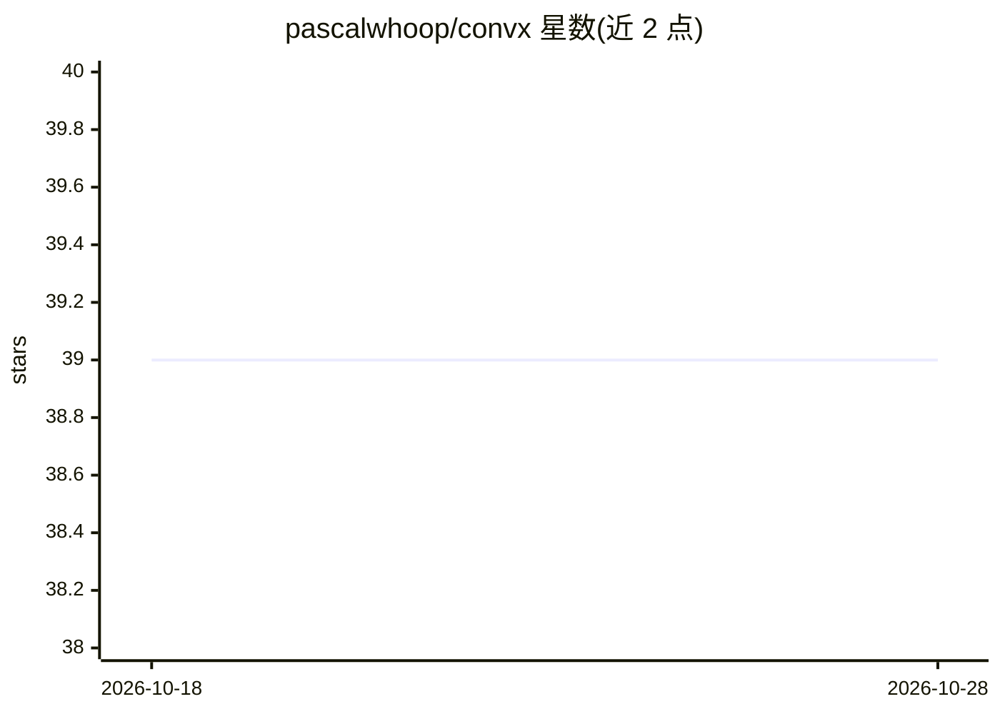

# pascalwhoop/convx

⭐ 39 · Python · MIT · 推送 2026-03-06 · [GitHub](https://github.com/pascalwhoop/convx) · [官网](https://pypi.org/project/convx-ai/) · 个人维护

**把 Codex/Claude/Cursor/Gemini 会话导出为 Git 仓库的工具**

扫描本地的 Codex JSONL、Claude projects、Cursor workspaceStorage 与 Gemini CLI 会话文件，将各来源会话归一化为统一模型后，按用户与来源系统组织写入 Git 仓库：每个会话生成可读的 Markdown 转录与隐藏的归一化 JSON。提供 sync（写入当前项目仓库）与 backup（导出到专用备份仓库）两种模式，基于 `.convx/index.json` 与源文件 SHA-256 指纹实现幂等增量；导出默认脱敏 API key、token 与密码。另含 stats、TUI 浏览 explore 与 pre-commit hook 命令。面向使用多种 AI 编码工具并希望留存会话历史的开发者。

## 筛选速览

| 维度 | 判定 | 备注 |
|---|---|---|
| AI 角色 | `ai-ecosystem` | LLM/agent 周边工具 |
| 许可风险 | `permissive` | MIT |
| 部署形态 | `library` | 以包/库形式分发 |
| 模型依赖 | — | README 未给出锁定关系 |
| 硬件要求 | — | 无带数字的原话,不猜 |
| 安装摩擦 | `low` | 无编译、无系统依赖或容器化 |
| 成熟度 | — | 结构信号不足 |

## 能力要点

- 支持 Codex、Claude、Cursor（含多根工作区）、Gemini CLI 四类会话来源
- 每会话输出 Markdown 转录与归一化 JSON，按用户/来源系统组织
- SHA-256 指纹 + index.json 实现幂等增量导出
- 导出默认脱敏密钥，并提供 pre-commit hook 在每次提交前自动同步

## 适用场景

- 把 AI 编码助手的会话记录随项目一起纳入 Git 版本管理
- 为多家 AI 工具的对话历史建立统一备份仓库
- 在终端里浏览和检索已导出的历史会话

## 场景标签

 · 领域:开发者工具/AI 会话管理

## 证据(README 行号)

> L3: Export AI conversation sessions into a Git repository using a readable, time-based structure.
> L7: - Scans source session files (Codex JSONL, Claude projects, Cursor workspaceStorage, Gemini CLI sessions).

## 星数曲线

2026-10-18 39 → 2026-10-28 39（+0）

---
*卡片 v1 · prompt 1.4 · 生成 2026-10-25 · 置信度 high · 依据 README sha `4f93445f910c` · [字段定义](../../DATASET.md)*
