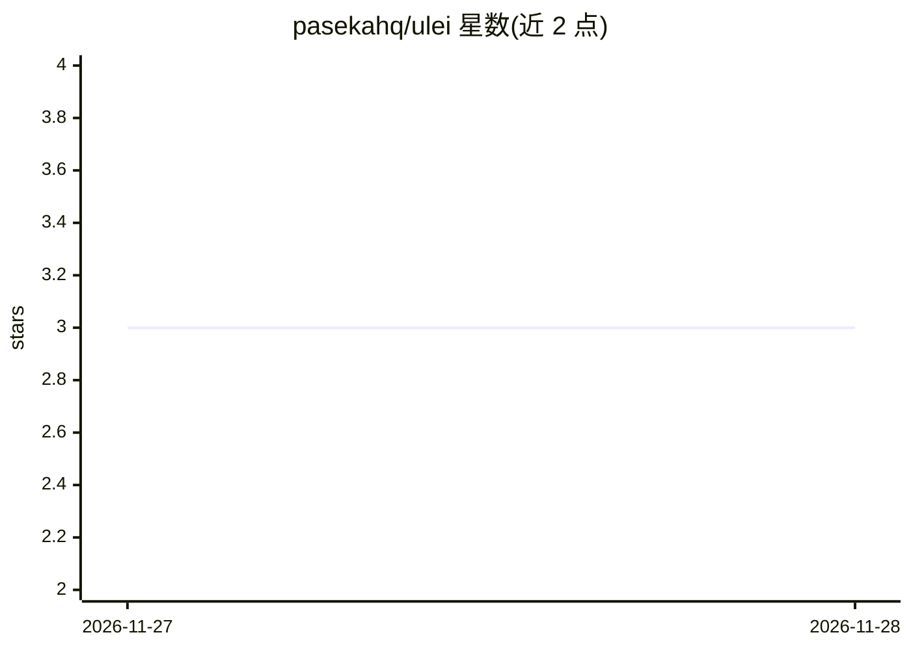

# pasekahq/ulei

⭐ 3 · Rust · AGPL-3.0 · 推送 2026-11-27 · [GitHub](https://github.com/pasekahq/ulei) · 个人维护

**给自托管个人 AI 助手搭的 Rust agent 生态工作台**

一个 Rust cargo workspace，承载个人 agent 生态的外围组件：自有 agent 循环（ulei-engine，仅经 qb 模型网关调用模型）、Telegram 所有者通道、所有者收件箱、归档记忆守护进程、源连接器运行器等，模块间仅通过 JSON Schema 合约通信且禁止相互依赖。预发布（pre-alpha）状态，尚无 release，明确声明不可使用；现有 Python hive 仍在运行，后续由 Rust 实现替换。构建需要 Rust stable（MSRV 1.89），Linux 下以 musl 静态二进制发布。

## 筛选速览

| 维度 | 判定 | 备注 |
|---|---|---|
| AI 角色 | `ai-ecosystem` | LLM/agent 周边工具 |
| 许可风险 | `viral` | AGPL-3.0 |
| 部署形态 | `None` |  |
| 模型依赖 | — | README 未给出锁定关系 |
| 硬件要求 | — | 无带数字的原话,不猜 |
| 安装摩擦 | `low` | 无编译、无系统依赖或容器化 |
| 成熟度 | `idea` | |

## 能力要点

- 自有 agent 循环，模型调用只经 qb 网关
- 语言无关的 JSON Schema/OpenAPI 合约与模块边界强制检查
- 源连接器运行器：systemd 用户单元隔离、Landlock/seccomp 限制与网络代理（broker）
- ulei status 命令一次性探测 inbox、engine、qb 网关等守护进程状态

## 适用场景

- 自托管搭建个人的多通道 agent 助手框架
- 通过 Telegram 作为所有者与 agent 的交互通道
- 以合约驱动的方式在多语言组件间接入自有 agent 运行时

## 场景标签

`AI 助手` `Agent 框架` · 领域:Agent 开发

## 证据(README 行号)

> L11: **Status:** pre-alpha, building the MVP (see roadmap). The agent loop
> L29: |`ulei-engine`|own agent loop: tools, sessions; models only through the qb gateway|
> L74: fixtures and a changelog, so components in any language (including the existing Python

## 星数曲线

2026-11-27 3 → 2026-11-28 3（+0）

---
*卡片 v1 · prompt 1.4 · 生成 2026-11-27 · 置信度 high · 依据 README sha `8ee3e0c7361d` · [字段定义](../../DATASET.md)*
