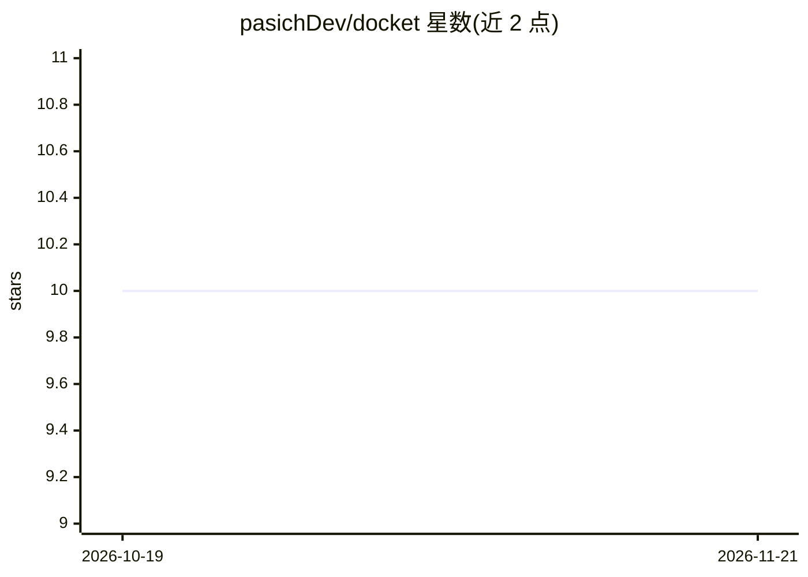

# pasichDev/docket

⭐ 10 · TypeScript · MIT · 推送 2026-10-04 · [GitHub](https://github.com/pasichDev/docket) · [官网](https://pasichdev.github.io/docket/) · 个人维护 · 中文 README

**给 AI 编码 agent 共享任务清单的本地优先协调工作区**

一个本地优先、可自托管的任务/待办协调工作区，通过 MCP server 让 Claude Code、Codex、Cursor、Windsurf、Zed、Warp 等 MCP host 共写同一份清单。按 git remote 自动归档项目作用域，支持认领/释放（15 分钟自动过期）、历史记录、Web 仪表盘（localhost:8787）、Claude Code SessionStart hook 注入未完成项（≤7 条、<120 tokens、失败即静默通过），以及由 agent 编译的 digest 汇总。不持有 GitLab/GitHub/Notion 凭据，数据存本地或自建 Server，支持设备间同步与 v7→v8 数据迁移回退。

## 筛选速览

| 维度 | 判定 | 备注 |
|---|---|---|
| AI 角色 | `ai-ecosystem` | LLM/agent 周边工具 |
| 许可风险 | `permissive` | MIT |
| 部署形态 | `library` | 以包/库形式分发 |
| 模型依赖 | — | README 未给出锁定关系 |
| 硬件要求 | — | 无带数字的原话,不猜 |
| 安装摩擦 | `low` | 无编译、无系统依赖或容器化 |
| 成熟度 | — | 结构信号不足 |

## 能力要点

- MCP server 形式接入 6 种 host，配置表逐一给出
- 按 git remote 自动按项目归档，支持跨设备同步
- Claude Code SessionStart hook 注入项目未完成项，可 DOCKET_HOOKS=off 关闭
- digest skill 汇总 MR/PR/Notion/本地提交并发布为仪表盘首页

## 适用场景

- 会话中随手让 agent 记一条 todo，稍后再决定是否升级为 issue
- 多个 AI 编码工具跨项目共享同一份任务清单
- 让 agent 定期编译工作/学习/侧项目的进展 digest
- 团队成员（人或 agent）认领任务并留痕

## 场景标签

 · 领域:开发工具/任务协调

## 证据(README 行号)

> L18: **You need:** Node.js 18+ and at least one MCP host — Claude Code, Codex,
> L149:     "docket": { "command": "npx", "args": ["-y", "@pasichdev/docket"] }

## 星数曲线

2026-10-19 10 → 2026-11-21 10（+0）

---
*卡片 v1 · prompt 1.4 · 生成 2026-11-19 · 置信度 high · 依据 README sha `43998c664313` · [字段定义](../../DATASET.md)*
