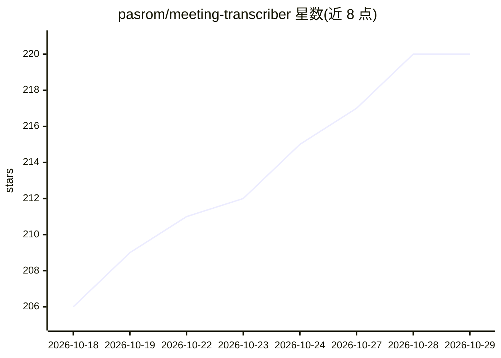

# pasrom/meeting-transcriber

⭐ 220 · Swift · MIT · 推送 2026-10-28 · [GitHub](https://github.com/pasrom/meeting-transcriber) · [官网](https://meetingtranscriber.app) · 个人维护

**macOS 本地会议转录器：录音、转录、说话人分离全在设备端**

macOS 菜单栏应用，自动检测 Teams/Zoom/Webex 会议并双轨录音（应用音频+麦克风），在设备端完成转录（WhisperKit 或 Parakeet TDT v3）、说话人分离（FluidAudio via CoreML/ANE）与说话人识别，再经 Claude Code CLI 或任意 OpenAI 兼容端点（Ollama/LM Studio）生成 Markdown 纪要。支持多格式文件导入、自定义词汇表、仅录音模式与 localhost 自动化 API。要求 macOS 14.2+，全程无云端、无订阅。

## 筛选速览

| 维度 | 判定 | 备注 |
|---|---|---|
| AI 角色 | `ai-native` | 本体是模型或模型工具 |
| 许可风险 | `permissive` | MIT |
| 部署形态 | `None` |  |
| 模型依赖 | local-ok | 支持本地模型 |
| 硬件要求 | — | 无带数字的原话,不猜 |
| 安装摩擦 | `medium` | 含编译或系统依赖之一 |
| 成熟度 | — | 结构信号不足 |

## 能力要点

- 双轨录音 + 双轨分别做说话人分离，避免回声干扰
- 双转录引擎可选：WhisperKit（99+语言）与 Parakeet TDT v3（约50MB模型）
- CoreML/ANE 上的设备端说话人分离，无需 HuggingFace token
- 协议生成可选 Claude CLI、OpenAI 兼容 API 或关闭

## 适用场景

- 在保密场景（法务/医疗/NDA）本地录制并转录线上会议
- 导入录音/视频文件离线生成带说话人标记的纪要
- 通过 localhost 自动化 API 无头驱动转录流水线

## 场景标签

`语音识别` · 领域:感知与多模态

## 证据(README 行号)

> L3: > **The local-first meeting transcriber for macOS.** Records Teams, Zoom, and Webex calls, transcribes them on-devic
> L53: - **On-device transcription** — Two engines, selectable in Settings:
> L57: - **On-device speaker diarization** — FluidAudio via CoreML/ANE — no HuggingFace token needed; two modes: standard 

## 星数曲线

2026-10-18 206 → 2026-10-29 220（+14）

---
*卡片 v1 · prompt 1.4 · 生成 2026-10-22 · 置信度 high · 依据 README sha `1931fb84a2c1` · [字段定义](../../DATASET.md)*
