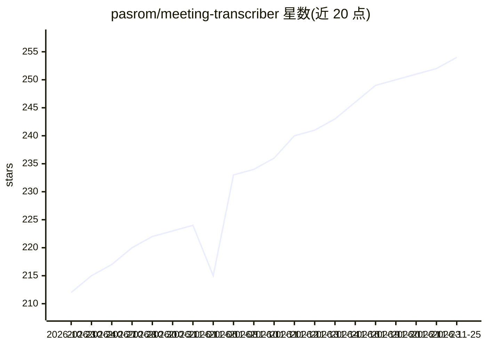

# pasrom/meeting-transcriber

⭐ 254 · Swift · MIT · 推送 2026-11-23 · [GitHub](https://github.com/pasrom/meeting-transcriber) · [官网](https://meetingtranscriber.app) · 个人维护

**macOS 本地会议转录器：自动录制 Teams/Zoom/Webex 并端侧转写与分说话人**

面向 macOS 14.2+ 的菜单栏应用，检测到 Teams/Zoom/Webex 会议时自动双轨录制（应用音频+麦克风），在设备端用 WhisperKit 或 Parakeet TDT v3 转写，经 FluidAudio 说话人分离后，通过 Claude Code CLI 或 OpenAI 兼容端点（Ollama/LM Studio 等）生成 Markdown 会议纪要；也可仅保存转写。全流程本地运行，无需账号与订阅，音频不上传。支持多格式文件导入、自定义词表、Notion 导出、HTTP 自动化 API；MKV/WebM 需另装 ffmpeg。

## 筛选速览

| 维度 | 判定 | 备注 |
|---|---|---|
| AI 角色 | `ai-native` | 本体是模型或模型工具 |
| 许可风险 | `permissive` | MIT |
| 部署形态 | `None` |  |
| 模型依赖 | local-ok | 支持本地模型 |
| 硬件要求 | — | 无带数字的原话,不猜 |
| 安装摩擦 | `medium` | 含编译或系统依赖之一 |
| 成熟度 | — | 结构信号不足 |

## 能力要点

- 端侧转录双引擎：WhisperKit（99+ 语言）与 Parakeet TDT v3（25 种欧洲语言）
- 双轨说话人分离（FluidAudio/CoreML/ANE），支持最多 8 说话人的重叠感知模式
- 会议纪要生成可接 Claude Code CLI 或任意 OpenAI 兼容 API，可完全关闭
- 本地自动化 API：POST 音频文件返回带说话人标注的转写

## 适用场景

- 法务/医疗/保密会议需要音频不出本机的转录与纪要
- 离线环境下录制并转写 Teams/Zoom/Webex 会议
- 用本地 LLM 生成可控提示词的会议纪要
- 把录音交给外部 GPU 主机做批量处理（record-only 模式）

## 场景标签

`语音识别` · 领域:感知与多模态

## 证据(README 行号)

> L3: > **The local-first meeting transcriber for macOS.** Records Teams, Zoom, and Webex calls, transcribes them on-devic
> L53: - **On-device transcription** — Two engines, selectable in Settings:
> L62: - **AI meeting notes generation** — Structured Markdown via Claude Code CLI, OpenAI-compatible APIs (Ollama, LM Stu

## 星数曲线

2026-10-23 212 → 2026-11-25 254（+42）

---
*卡片 v1 · prompt 1.4 · 生成 2026-11-25 · 置信度 high · 依据 README sha `61129e50467f` · [字段定义](../../DATASET.md)*
