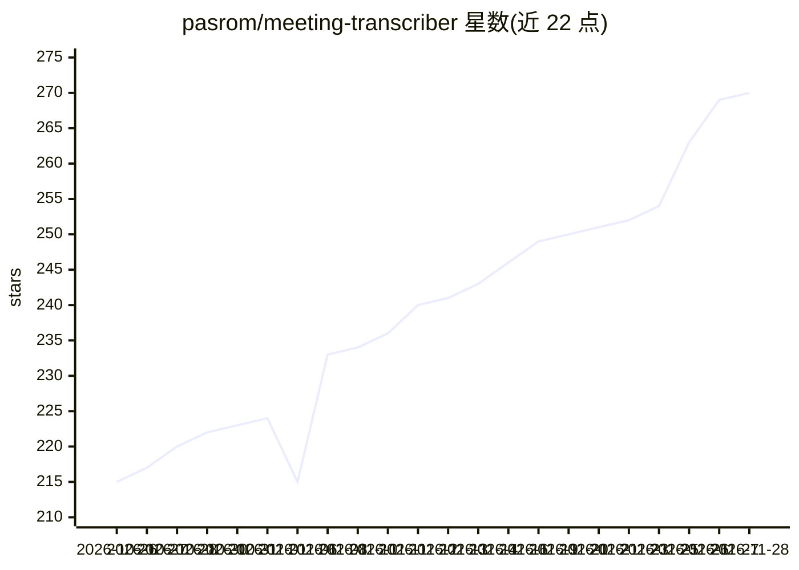

# pasrom/meeting-transcriber

⭐ 270 · Swift · MIT · 推送 2026-11-27 · [GitHub](https://github.com/pasrom/meeting-transcriber) · [官网](https://meetingtranscriber.app) · 个人维护

**macOS 本地会议转写工具：自动录制并本地转写 Teams/Zoom/Webex**

面向 macOS 的菜单栏应用，检测到 Teams/Zoom/Webex 会议时自动录制系统音频与麦克风双轨，使用 WhisperKit 或 Parakeet 在设备端转写，经 FluidAudio 做说话人分离，并借助 Claude Code CLI 或 OpenAI 兼容端点（Ollama、LM Studio 等）生成为 Markdown 会议纪要。支持自定义词表、说话人识别、多格式文件导入、Notion 导出及本地 HTTP 自动化接口。要求 macOS 14.2+，通过 Homebrew Cask 安装或源码构建。

## 筛选速览

| 维度 | 判定 | 备注 |
|---|---|---|
| AI 角色 | `ai-native` | 本体是模型或模型工具 |
| 许可风险 | `permissive` | MIT |
| 部署形态 | `None` |  |
| 模型依赖 | local-ok | 支持本地模型 |
| 硬件要求 | — | 无带数字的原话,不猜 |
| 安装摩擦 | `medium` | 含编译或系统依赖之一 |
| 成熟度 | — | 结构信号不足 |

## 能力要点

- 双轨录制与分别做说话人分离（dual-track diarization）
- WhisperKit（99+ 语言）与 Parakeet TDT v3（25 种欧洲语言）两种本地转写引擎可选
- 通过 power assertions 自动检测会议，无需屏幕录制权限
- 本地 HTTP 自动化 API 支持 headless 调用流水线

## 适用场景

- 涉密/NDA 会议需要全程离线的录音转写纪要
- 自动录制并归档线上会议的 Markdown 笔记
- 用本地 LLM 按自定义提示词生成结构化会议纪要
- 把录音导出给外部 GPU 主机做批量转写处理

## 场景标签

`语音识别` · 领域:感知与多模态

## 证据(README 行号)

> L3: > **The local-first meeting transcriber for macOS.** Records Teams, Zoom, and Webex calls, transcribes them on-devic
> L18: Meeting Transcriber runs the entire pipeline (recording, transcription, speaker diarization, summarization) on your
> L53: - **On-device transcription** — Two engines, selectable in Settings:

## 星数曲线

2026-10-26 215 → 2026-11-28 270（+55）

---
*卡片 v1 · prompt 1.4 · 生成 2026-11-26 · 置信度 high · 依据 README sha `753811c71233` · [字段定义](../../DATASET.md)*
