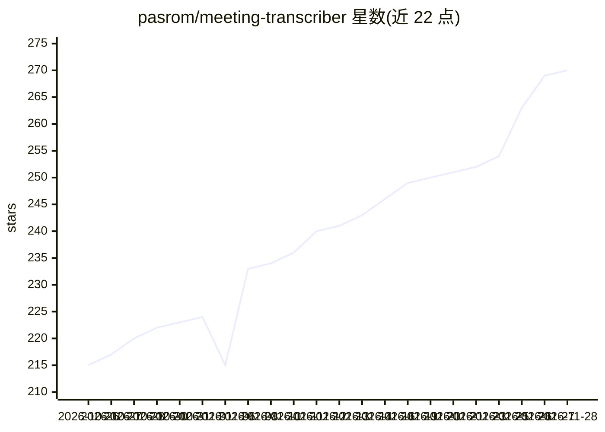

# pasrom/meeting-transcriber

⭐ 270 · Swift · MIT · 推送 2026-11-27 · [GitHub](https://github.com/pasrom/meeting-transcriber) · [官网](https://meetingtranscriber.app) · 个人维护

**macOS 本地会议转录工具：自动录制并离线生成会议纪要**

面向 macOS 的菜单栏应用：自动检测 Teams/Zoom/Webex 会议并双轨录制（应用音频+麦克风），在本机用 WhisperKit 或 Parakeet TDT v3 转录，经 FluidAudio 声纹分离说话人，再通过 Claude Code CLI 或 OpenAI 兼容端点（Ollama、LM Studio 等）生成 Markdown 会议纪要；全程本地处理，无账户与订阅。支持自定义词表、说话人识别、Notion 导出、record-only 外接处理模式及本地 HTTP 自动化 API。需 macOS 14.2+，摘要需配置一个 LLM 提供方。

## 筛选速览

| 维度 | 判定 | 备注 |
|---|---|---|
| AI 角色 | `ai-native` | 本体是模型或模型工具 |
| 许可风险 | `permissive` | MIT |
| 部署形态 | `None` |  |
| 模型依赖 | local-ok | 支持本地模型 |
| 硬件要求 | — | 无带数字的原话,不猜 |
| 安装摩擦 | `medium` | 含编译或系统依赖之一 |
| 成熟度 | — | 结构信号不足 |

## 能力要点

- 本地双引擎转录：WhisperKit（99+ 语言）与 Parakeet TDT v3（25 种欧盟语言，~50 MB）
- 双轨 diarization：应用音频与麦克风分别分离说话人，最多支持 8 人（Nemotron 3）
- 摘要 LLM 可选：Claude Code CLI、Ollama、LM Studio 或任意 OpenAI 兼容 API
- 本地自动化 API 与 live transcript 文件，可被本地 agent 调用

## 适用场景

- 开会时自动录制并生成本地会议纪要，音频不出本机
- 法律/医疗/NDA 场景下替代云端记录服务
- 用本地 Ollama 模型按自定义 prompt 生成结构化纪要
- 通过本地 HTTP API 把转录流水线接入自己的工作流

## 场景标签

`语音识别` · 领域:感知与多模态

## 证据(README 行号)

> L3: > **The local-first meeting transcriber for macOS.** Records Teams, Zoom, and Webex calls, transcribes them on-devic
> L62: - **AI meeting notes generation** — Structured Markdown via Claude Code CLI, OpenAI-compatible APIs (Ollama, LM Stu

## 星数曲线

2026-10-26 215 → 2026-11-28 270（+55）

---
*卡片 v1 · prompt 1.4 · 生成 2026-11-28 · 置信度 high · 依据 README sha `ef069c9783eb` · [字段定义](../../DATASET.md)*
