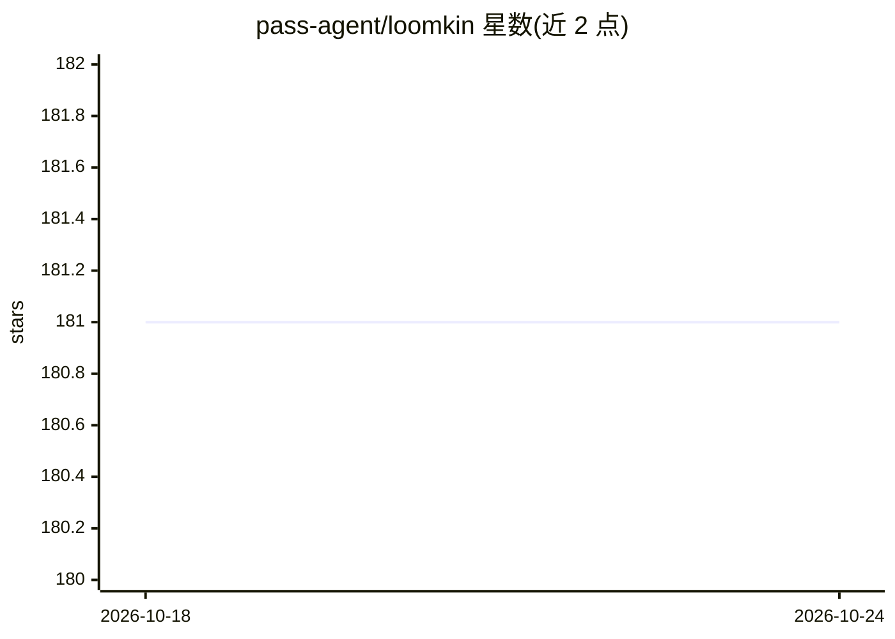

# pass-agent/loomkin

⭐ 181 · Elixir · MIT · 推送 2026-05-17 · [GitHub](https://github.com/pass-agent/loomkin) · 个人维护

**Elixir/OTP 多智能体团队平台，含实时任务控制台 UI**

基于 Erlang/OTP 与 Phoenix LiveView 的多智能体协作平台：每个智能体为 GenServer 进程，支持 <500ms 生成、5 种内置角色、点对点评审、任务协商、自愈与验证循环；通过决策图（PostgreSQL DAG）与 Keeper 进程的上下文网格实现跨会话持久记忆。提供 39 组件的零手写 JS 任务控制台界面、58 个内置工具、16 个 LLM 提供商 + 665 模型（req_llm）及 Ollama 本地通道，支持 MCP 双向与技能发布安装。需 Elixir 1.20+/OTP 28+、Docker、Node.js 22，从源码克隆运行。

## 筛选速览

| 维度 | 判定 | 备注 |
|---|---|---|
| AI 角色 | `ai-native` | 本体是模型或模型工具 |
| 许可风险 | `permissive` | MIT |
| 部署形态 | `self-host` | docker 或自建部署 |
| 模型依赖 | local-ok | 支持本地模型 |
| 硬件要求 | — | 无带数字的原话,不猜 |
| 安装摩擦 | `low` | 无编译、无系统依赖或容器化 |
| 成熟度 | — | 结构信号不足 |

## 能力要点

- OTP 原生智能体团队：<500ms 生成、PubSub 微秒级通信、每节点 100+ 并发
- 决策图持久记忆与 Keeper 上下文网格，跨会话保留目标、权衡与失败教训
- 16 个 LLM 提供商 + 665 模型，另支持 Ollama 本地运行
- MCP 服务端+客户端双向集成，技能可从社区或 git 仓库安装

## 适用场景

- 以多智能体团队协作完成编码与测试修复任务
- 在实时 UI 中观察、审批和干预智能体的工作过程
- 混合使用便宜模型与高成本模型控制团队开销

## 场景标签

`多智能体` · 领域:Agent 开发

## 证据(README 行号)

> L13: Spawn specialists in milliseconds. Share discoveries in real-time. Review each other's work. Debate approaches and 
> L15: Watch it all unfold from a live mission control UI. Built on Erlang/OTP.
> L27: - **58 built-in tools**, 16 LLM providers, 665+ models via req_llm, plus Ollama for local LLMs

## 星数曲线

2026-10-18 181 → 2026-10-24 181（+0）

---
*卡片 v1 · prompt 1.4 · 生成 2026-10-23 · 置信度 mid · 依据 README sha `297447aae201` · [字段定义](../../DATASET.md)*
