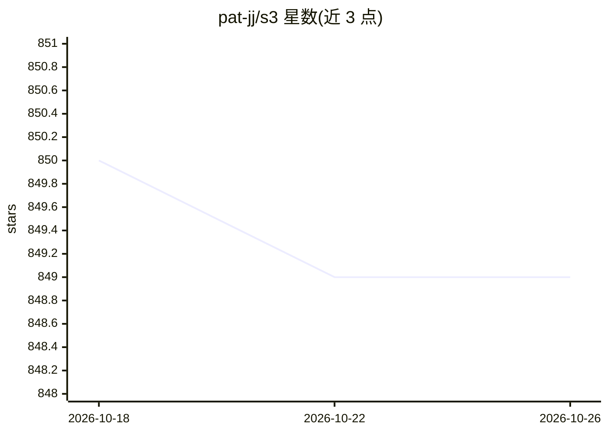

# pat-jj/s3

⭐ 849 · Python · Apache-2.0 · 推送 2025-11-05 · [GitHub](https://github.com/pat-jj/s3) · [官网](https://arxiv.org/abs/2505.14146) · 组织维护 · 中文 README

**用强化学习训练 RAG 搜索 agent 的框架，少数据可训**

EMNLP'25 论文配套的开源框架 s3：在检索增强生成（RAG）中仅训练搜索（searcher）模块，不改生成器本体，通过强化学习让语言模型学会更有效的检索，配合任意黑盒 LLM 使用。提供基于 conda 的两套环境安装、索引与语料下载、naïve RAG 缓存预计算、训练与推理脚本，并内置 RAG、DeepRetrieval、Search-R1、IRCoT、Search-o1 五个基线的运行脚本与评测流程；另提供约一小时训练出的参考 checkpoint（s3-8-3-3-20steps）。

## 筛选速览

| 维度 | 判定 | 备注 |
|---|---|---|
| AI 角色 | `ai-ecosystem` | LLM/agent 周边工具 |
| 许可风险 | `permissive` | Apache-2.0 |
| 部署形态 | `library` | 以包/库形式分发 |
| 模型依赖 | local-ok | 支持本地模型 |
| 硬件要求 | — | 无带数字的原话,不猜 |
| 安装摩擦 | `medium` | 含编译或系统依赖之一 |
| 成熟度 | — | 结构信号不足 |

## 能力要点

- RL 仅训练搜索模块，不改动生成器，兼容任意黑盒 LLM
- 内置 5 个基线（RAG/DeepRetrieval/Search-R1/IRCoT/Search-o1）的运行与统一评测脚本
- 支持自定义语料/数据集构建训练管线
- 提供参考 checkpoint 与可复现实验流程

## 适用场景

- 在自有语料上训练 RAG 搜索 agent
- 与主流搜索 agent 方法做基线对比实验
- 复现论文结果或从零训练搜索模型

## 场景标签

`RAG` `强化学习` · 领域:知识与检索

## 证据(README 行号)

> L41: `s3` is a simple yet powerful framework for training search agents in retrieval-augmented generation (RAG). It teac
> L157:   title={s3: You Don't Need That Much Data to Train a Search Agent via RL},

## 星数曲线

2026-10-18 850 → 2026-10-26 849（-1）

---
*卡片 v1 · prompt 1.4 · 生成 2026-10-21 · 置信度 high · 依据 README sha `49ec9b782596` · [字段定义](../../DATASET.md)*
