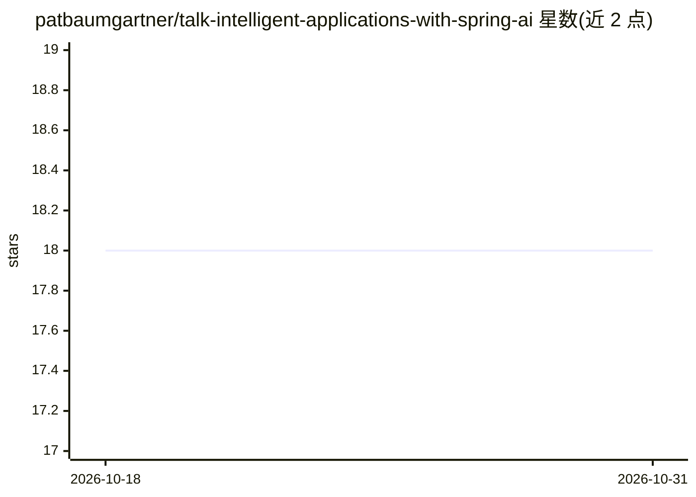

# patbaumgartner/talk-intelligent-applications-with-spring-ai

⭐ 18 · 推送 2026-09-07 · [GitHub](https://github.com/patbaumgartner/talk-intelligent-applications-with-spring-ai) · [官网](https://github.com/patbaumgartner/talk-intelligent-applications-with-spring-ai/blob/main/intelligent-applications-with-spring-ai.pdf) · 个人维护

**关于用 Spring AI 构建 LLM 应用的大会演讲资料库**

Patrick Baumgartner（42talents，Java Champion）的会议演讲仓库，主题为基于 Spring AI 在企业环境中集成 LLM：涵盖聊天交互、图像生成、音频转录等场景的模型功能与实务集成方式。仓库本体为演讲介绍与讲者信息，附幻灯片获取链接，不含可安装运行的代码或构建产物。面向参加技术演讲、了解 Spring AI 集成实践的开发者。

## 筛选速览

| 维度 | 判定 | 备注 |
|---|---|---|
| AI 角色 | `ai-knowledge` | 知识聚合/清单类 |
| 许可风险 | `none` | — |
| 部署形态 | `None` |  |
| 模型依赖 | — | README 未给出锁定关系 |
| 硬件要求 | — | 无带数字的原话,不猜 |
| 安装摩擦 | `low` | 无编译、无系统依赖或容器化 |
| 成熟度 | — | 结构信号不足 |

## 能力要点

- 主题覆盖聊天交互、图像生成、音频转录三类 LLM 应用场景
- 以 Spring AI / Spring Boot 为技术基础的实务集成讲解
- 提供演讲幻灯片链接

## 适用场景

- 了解 Spring AI 在企业应用中集成 LLM 的方式
- 作为 Java/Spring 技术栈引入 AI 能力的学习资料

## 场景标签

`教程课程` · 领域:学习与行业

## 证据(README 行号)

> L5: In this talk, we will look at different language models (LLMs) and explore their application in different scenarios 
> L7: Get the slides here!

## 星数曲线

2026-10-18 18 → 2026-10-31 18（+0）

---
*卡片 v1 · prompt 1.4 · 生成 2026-10-29 · 置信度 high · 依据 README sha `463a33ec1e27` · [字段定义](../../DATASET.md)*
