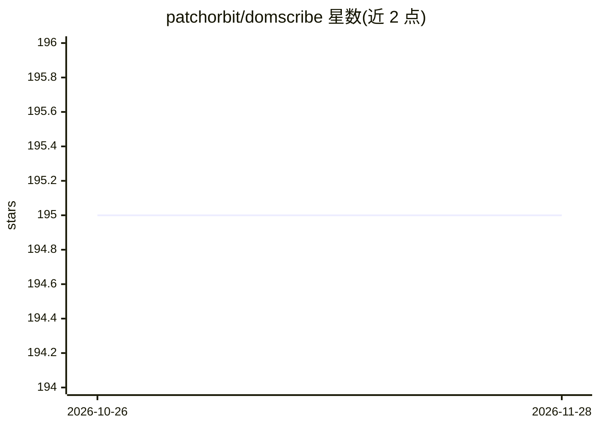

# patchorbit/domscribe

⭐ 195 · TypeScript · MIT · 推送 2026-11-17 · [GitHub](https://github.com/patchorbit/domscribe) · [官网](https://domscribe.com) · 组织维护

**让 AI 编码代理看见运行中前端并按元素改代码的开发工具**

在浏览器与 AI 编码代理之间建立双向通道：点击页面元素生成带源码位置与运行时上下文（props、state、DOM 快照）的标注，由代理认领并修改对应源文件；代理也可通过 MCP 工具按源码路径查询实时渲染结果。通过打包器插件在构建期注入稳定 data-ds ID，生产构建自动剥离插桩。需开发服务器运行，MIT 许可，以 npm CLI 与 MCP 服务器形式分发，支持 React/Vue/Next.js/Nuxt 及 Vite/Webpack/Turbopack。

## 筛选速览

| 维度 | 判定 | 备注 |
|---|---|---|
| AI 角色 | `ai-ecosystem` | LLM/agent 周边工具 |
| 许可风险 | `permissive` | MIT |
| 部署形态 | `library` | 以包/库形式分发 |
| 模型依赖 | — | README 未给出锁定关系 |
| 硬件要求 | — | 无带数字的原话,不猜 |
| 安装摩擦 | `low` | 无编译、无系统依赖或容器化 |
| 成熟度 | — | 结构信号不足 |

## 能力要点

- 12 个 MCP 工具 + 4 个 prompt，支持按源码行查询实时 DOM/props/state
- 点击元素的 UI→代码标注工作流，代理经 WebSocket 实时回传响应
- AST 注入 xxhash64 稳定 ID，生产构建剥离插桩并在 CI 强制
- PII 自动脱敏，标注以 JSON 存于仓库 .domscribe/ 目录

## 适用场景

- 让 AI 代理按页面元素精确修改前端组件代码
- 代理在改码前查询某行源码在浏览器中的实际渲染效果
- 团队以标注方式排队收集页面改动需求并交给代理处理

## 场景标签

`编码 Agent` · 领域:编码与开发

## 证据(README 行号)

> L32: Domscribe bridges both directions: click a DOM element to tell your agent what to change, or let your agent query a
> L184: Domscribe exposes 12 tools and 4 prompts via MCP. Agent plugins bundle the MCP config and a skill file that teache
> L252: |MCP tools|✅ 12 tools + 4 prompts|❌ Proprietary protocol (Karton)|✅ 9 tools|⚠️ Lightweight add-on|❌ Internal MCP o

## 星数曲线

2026-10-26 195 → 2026-11-28 195（+0）

---
*卡片 v1 · prompt 1.4 · 生成 2026-11-25 · 置信度 high · 依据 README sha `6e2a931cba3b` · [字段定义](../../DATASET.md)*
