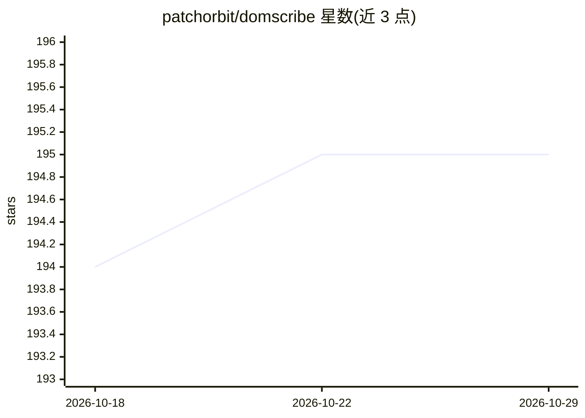

# patchorbit/domscribe

⭐ 195 · TypeScript · MIT · 推送 2026-10-28 · [GitHub](https://github.com/patchorbit/domscribe) · [官网](https://domscribe.com) · 组织维护

**让 AI 编程 agent 看见运行中前端并定位源码的 MCP 工具**

面向使用 AI 编程 agent 的前端开发者：通过构建时 AST 注入稳定 data-ds ID，建立 DOM 元素与源码行号的双向映射；agent 可按文件与行号查询运行时 props/state/DOM 快照，用户也可在浏览器覆盖层点击元素并用自然语言提交修改标注，由 agent 认领实现。经 MCP 暴露 12 个工具与 4 个 prompt，支持 React/Vue/Next.js/Nuxt 与 Vite/Webpack/Turbopack，通过本地 Fastify 守护进程中转，生产构建剥离全部插桩并做 PII 脱敏。限制：需 dev server 运行且浏览器打开目标页面。

## 筛选速览

| 维度 | 判定 | 备注 |
|---|---|---|
| AI 角色 | `ai-ecosystem` | LLM/agent 周边工具 |
| 许可风险 | `permissive` | MIT |
| 部署形态 | `library` | 以包/库形式分发 |
| 模型依赖 | locked-api |  |
| 硬件要求 | — | 无带数字的原话,不猜 |
| 安装摩擦 | `low` | 无编译、无系统依赖或容器化 |
| 成熟度 | — | 结构信号不足 |

## 能力要点

- 构建时 AST 注入 HMR 稳定的 data-ds ID 与 JSONL 映射清单
- 双向能力：agent 按源码位置查询运行时上下照；浏览器点选元素提交标注
- MCP 暴露 12 个工具 + 4 个 prompt，兼容任意 MCP 客户端
- React fiber / Vue VNode 深度运行时捕获，生产构建零影响与 PII 脱敏

## 适用场景

- 让 Claude Code 等 agent 修改 UI 前先查看元素的真实运行时状态
- 在浏览器里点选元素、用自然语言描述需求并交由 agent 实现
- 编辑前后快照对比，验证 agent 改动未破坏样式

## 场景标签

 · 领域:前端开发工具/AI 编程基础设施

## 证据(README 行号)

> L32: Domscribe bridges both directions: click a DOM element to tell your agent what to change, or let your agent query a
> L184: Domscribe exposes 12 tools and 4 prompts via MCP. Agent plugins bundle the MCP config and a skill file that teache
> L240: **4. Agent.** Your coding agent connects via MCP to **query by source** (see what any line looks like live) or **p

## 星数曲线

2026-10-18 194 → 2026-10-29 195（+1）

---
*卡片 v1 · prompt 1.4 · 生成 2026-10-22 · 置信度 high · 依据 README sha `1df9bb7baf79` · [字段定义](../../DATASET.md)*
