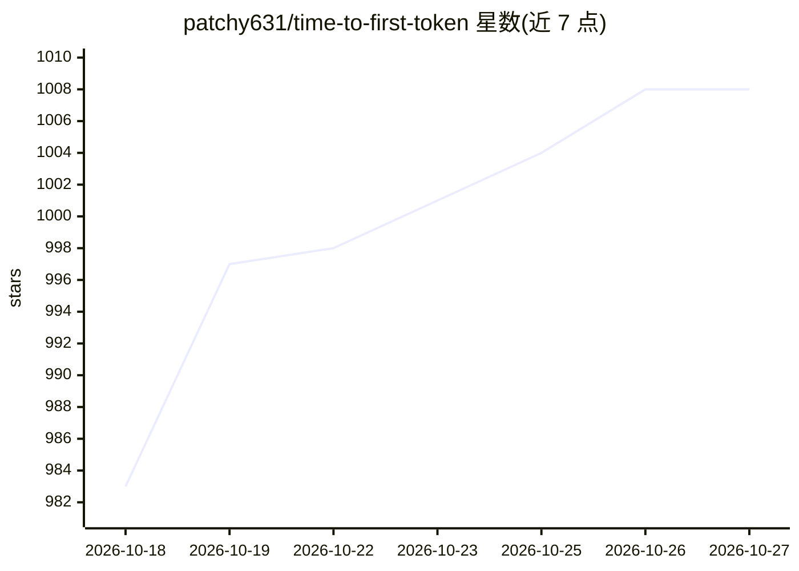

# patchy631/time-to-first-token

⭐ 1,008 · HTML · Apache-2.0 · 推送 2026-08-14 · [GitHub](https://github.com/patchy631/time-to-first-token) · 个人维护

**10 周 LLM 推理服务与优化实操学习路线图**

面向工程师的 10 周、每周 5 个 30 分钟会话的学习路线图，目标是交付一个 OpenAI 兼容推理服务：部署到租用 GPU、用 Prometheus/Grafana 做指标观测、以 1000+ 并发压测、做 FP8/INT4 量化和投机解码对比、加成本感知路由并发布可复现基准。路线覆盖 vLLM 与 SGLang 内部机制、RadixAttention、连续批处理等阅读材料。要求 Python 与 transformers 架构基础，需租用约一张 24GB GPU（两次会话需 H100）。

## 筛选速览

| 维度 | 判定 | 备注 |
|---|---|---|
| AI 角色 | `ai-knowledge` | 知识聚合/清单类 |
| 许可风险 | `permissive` | Apache-2.0 |
| 部署形态 | `library` | 以包/库形式分发 |
| 模型依赖 | local-ok | 支持本地模型 |
| 硬件要求 | — | 无带数字的原话,不猜 |
| 安装摩擦 | `medium` | 含编译或系统依赖之一 |
| 成熟度 | — | 结构信号不足 |

## 能力要点

- 50 个会话围绕单一持续演进的推理服务展开
- 产出 Grafana 监控、1000+ 并发压测 harness 与量化变体基准
- 覆盖 vLLM/SGLang 内部机制（PagedAttention、RadixAttention、chunked prefill）
- 租用 GPU 成本与时间投入（25 小时）有明确预算

## 适用场景

- 系统学习 LLM 推理服务部署与生产化优化
- 搭建可复现的推理基准测试与监控体系
- 理解量化与投机解码等优化手段的实测权衡

## 场景标签

`教程课程` · 领域:学习与行业

## 证据(README 行号)

> L5: A 10-week, 30-minutes-a-day roadmap for engineers who want to actually run LLM inference in production, not just rea
> L7: Fifty sessions. Every one of them feeds a single artifact: an OpenAI-compatible inference service that you deploy on
> L32: |Total|10 weeks, 50 sessions, 25 hours|

## 星数曲线

2026-10-18 983 → 2026-10-27 1,008（+25）

---
*卡片 v1 · prompt 1.4 · 生成 2026-10-21 · 置信度 mid · 依据 README sha `2e237b794b4c` · [字段定义](../../DATASET.md)*
