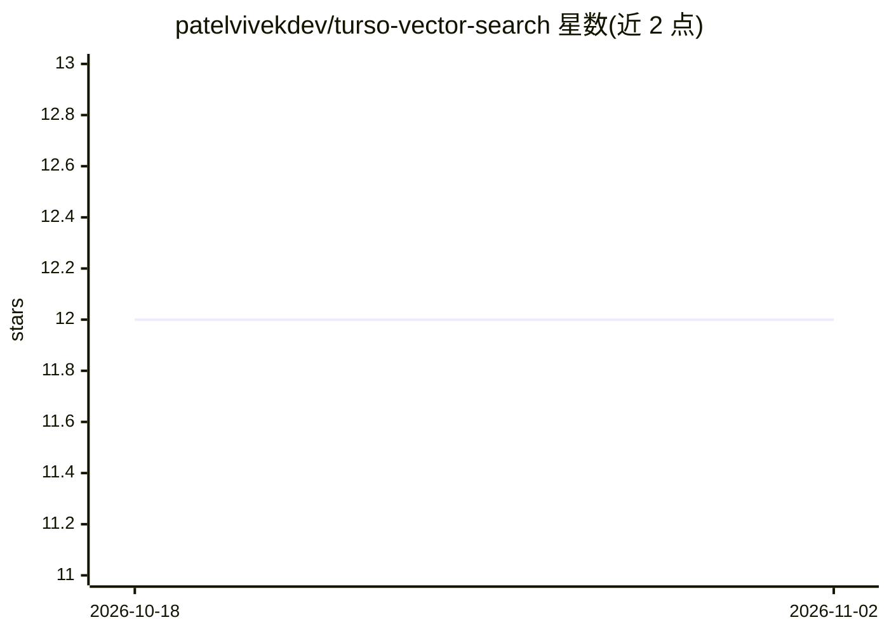

# patelvivekdev/turso-vector-search

⭐ 12 · TypeScript · 推送 2025-12-06 · [GitHub](https://github.com/patelvivekdev/turso-vector-search) · [官网](https://turso-vector-search.vercel.app) · 个人维护

**演示用 RAG 聊天机器人示例：Turso 向量库 + Gemini**

一个简单的 RAG 示例项目，演示如何结合 Turso 向量搜索 API、Drizzle ORM 与 Google Gemini 模型构建 AI 聊天机器人。安装与运行基于 Bun：通过 bun i 安装依赖，复制 .env.example 配置环境变量，运行 db:generate/db:migrate 迁移，在 Turso 上用 SQL 创建向量索引后以 bun run dev 启动开发服务器。面向想学习 Turso 向量搜索与 Vercel AI SDK 集成方式的开发者，属于教学演示性质而非生产级产品。

## 筛选速览

| 维度 | 判定 | 备注 |
|---|---|---|
| AI 角色 | `ai-native` | 本体是模型或模型工具 |
| 许可风险 | `none` | — |
| 部署形态 | `None` |  |
| 模型依赖 | — | README 未给出锁定关系 |
| 硬件要求 | — | 无带数字的原话,不猜 |
| 安装摩擦 | `low` | 无编译、无系统依赖或容器化 |
| 成熟度 | — | 结构信号不足 |

## 能力要点

- 演示 Turso Vector Search API 与 Drizzle ORM 的结合使用
- 以 Bun 为运行与安装工具链
- 在 embeddings 表上创建 libsql 向量索引

## 适用场景

- 学习如何用 Turso 做向量检索构建 RAG 应用
- 参考 Drizzle ORM 与向量数据库集成的写法
- 作为 Vercel AI SDK + Gemini 的起步模板

## 场景标签

`RAG` · 领域:知识与检索

## 证据(README 行号)

> L3: This is a simple RAG example of how to use the Turso Vector Search API with Drizzle ORM Google AI.
> L51: - patelvivekdev

## 星数曲线

2026-10-18 12 → 2026-11-02 12（+0）

---
*卡片 v1 · prompt 1.4 · 生成 2026-11-01 · 置信度 high · 依据 README sha `d08b144e08a8` · [字段定义](../../DATASET.md)*
