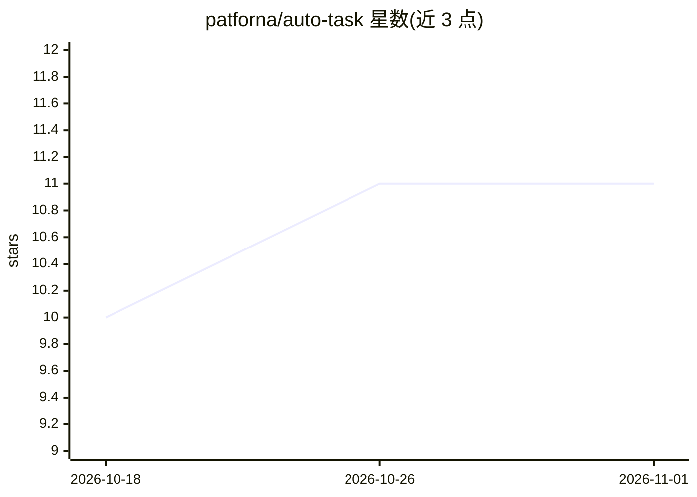

# patforna/auto-task

⭐ 11 · Shell · MIT · 推送 2026-09-08 · [GitHub](https://github.com/patforna/auto-task) · [官网](https://github.com/patforna/writing) · 个人维护

**面向资深工程师的 Claude Code 自主编码工作流插件**

以 Claude Code 插件形式提供的 agentic 工作流：将明确定义的任务文件经固定流水线（preflight、澄清、隔离 worktree、双模型规划、TDD 实现、双模型评审、证据引用的分诊、修复与验收核验）转化为可交付代码，最后由人在 ship 关卡决定是否合并。任务以纯 markdown 文件持久化于仓库，跨会话保存状态。默认以 Codex 作为第二模型族实现跨家族评审，缺失时回退为同族模型。通过 Claude Code 插件市场安装，作者声明为早期提取版本。

## 筛选速览

| 维度 | 判定 | 备注 |
|---|---|---|
| AI 角色 | `ai-native` | 本体是模型或模型工具 |
| 许可风险 | `permissive` | MIT |
| 部署形态 | `None` |  |
| 模型依赖 | — | README 未给出锁定关系 |
| 硬件要求 | — | 无带数字的原话,不猜 |
| 安装摩擦 | `low` | 无编译、无系统依赖或容器化 |
| 成熟度 | `idea` | |

## 能力要点

- create→preflight→plan→impl→review→verify→ship 固定流水线，中间步骤无人值守运行
- Claude + Codex 双模型族并行规划与对抗式评审，可配置其他第二模型
- 任务以纯 markdown 文件持久化于仓库，跨 agent 会话保存状态
- 每个任务使用独立 git worktree，支持并行运行；各步骤可作为独立 /at: 技能单独使用

## 适用场景

- 把明确定义的开发任务交给 agent 流水线自主完成并等待签署
- 用双模型族评审和证据引用分诊提升大改动交付的可靠性
- 在仓库内以任务文件方式管理和追踪 AI 实现过程

## 场景标签

`编码 Agent` `代码审查` · 领域:编码与开发

## 证据(README 行号)

> L7: _auto-task_ aims to deliver high-quality code with high autonomy. To achieve this, it combines human-curated skills 
> L30: create → [ preflight · clarify · worktree · plan · impl · review · triage · fix · verify ] → ship
> L74: For now, _auto-task_ works with Claude Code and uses Codex as a second model for multi-model-family panels. If Code

## 星数曲线

2026-10-18 10 → 2026-11-01 11（+1）

---
*卡片 v1 · prompt 1.4 · 生成 2026-11-01 · 置信度 high · 依据 README sha `046c0d39fac6` · [字段定义](../../DATASET.md)*
