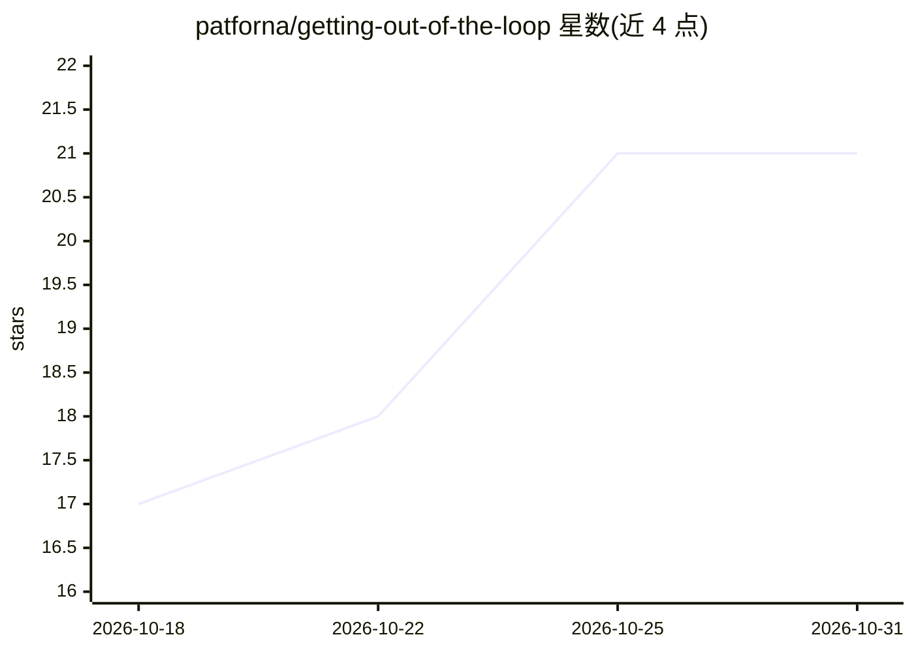

# patforna/getting-out-of-the-loop

⭐ 21 · 推送 2026-09-10 · [GitHub](https://github.com/patforna/getting-out-of-the-loop) · 个人维护

**8个月用 AI 独立构建的经验报告：关于 agent 协作的文章**

一篇长篇体验报告（25 分钟阅读量），作者 Patric Fornasier 记录 2025 年 10 月离职后用 AI（以 Claude Code 为主）独立构建量化基金系统的八个月经历。内容覆盖工具选型（对比 Cursor/Codex CLI/Gemini CLI/Claude Code）、从逐步提示到并行多 agent 的工作方式演变、倦怠与瓶颈问题、用自动化测试代替 CLAUDE.md 规则、以及多模型面板可提升实现质量的发现。属于写作/知识类仓库，非软件产品。

## 筛选速览

| 维度 | 判定 | 备注 |
|---|---|---|
| AI 角色 | `ai-knowledge` | 知识聚合/清单类 |
| 许可风险 | `none` | — |
| 部署形态 | `None` |  |
| 模型依赖 | — | README 未给出锁定关系 |
| 硬件要求 | — | 无带数字的原话,不猜 |
| 安装摩擦 | `low` | 无编译、无系统依赖或容器化 |
| 成熟度 | — | 结构信号不足 |

## 能力要点

- 记录从单个 agent 到并行运行 3-6 个 Claude Code 实例的工作方式演变
- 用机械化自动化测试替代 CLAUDE.md 规则以约束生成代码
- 多模型面板（panel/sop/synthesize）技能的实践方法
- 关于倦怠、瓶颈与系统 1/系统 2 思考的一手经验描述

## 适用场景

- 了解长期与 coding agent 协作的工程实践与陷阱
- 参考多模型协作提升实现质量的方法
- 阅读 AI 时代独立开发者工作方式的经验记录

## 场景标签

`教程课程` · 领域:学习与行业

## 证据(README 行号)

> L3: *An experience report · Patric Fornasier · September 2026 · 25 min read*
> L11: After quitting my job in October 2025, I decided to take some time off and focus full-time on building something no

## 星数曲线

2026-10-18 17 → 2026-10-31 21（+4）

---
*卡片 v1 · prompt 1.4 · 生成 2026-10-28 · 置信度 high · 依据 README sha `4e4d790af812` · [字段定义](../../DATASET.md)*
