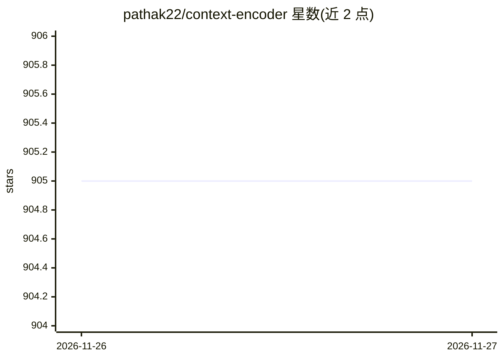

# pathak22/context-encoder

⭐ 905 · Lua · NOASSERTION · 推送 2026-11-24 · [GitHub](https://github.com/pathak22/context-encoder) · [官网](https://pathak22.github.io/context-encoder/) · 个人维护

**CVPR 2016 图像修复 GAN 的训练与演示代码**

CVPR 2016 论文 Context Encoders 的官方训练代码：通过重建损失与对抗损失联合训练的深度网络完成图像中心区域及任意随机区域的修复，用于无监督特征表示学习。基于 Soumith DCGAN 实现的分支改写，提供快速演示、中心区域修复与随机区域修复的训练/测试脚本，并附预训练模型下载脚本与 Caffe 特征模型。基于 Torch 框架运行，支持自定义数据集训练，GPU 训练参数在命令行指定。

## 筛选速览

| 维度 | 判定 | 备注 |
|---|---|---|
| AI 角色 | `ai-native` | 本体是模型或模型工具 |
| 许可风险 | `none` | NOASSERTION |
| 部署形态 | `None` |  |
| 模型依赖 | — | README 未给出锁定关系 |
| 硬件要求 | — | 无带数字的原话,不猜 |
| 安装摩擦 | `low` | 无编译、无系统依赖或容器化 |
| 成熟度 | — | 结构信号不足 |

## 能力要点

- 图像修复（inpainting）模型训练与测试代码，含中心区域与任意随机区域两种模式
- 重建损失与对抗损失联合训练的无监督特征学习
- 提供预训练模型下载脚本与快速演示流程
- 另提供 Caffe 特征模型与第三方 TensorFlow 实现链接

## 适用场景

- 复现 CVPR 2016 Context Encoders 论文结果
- 用自己的数据集训练图像修复模型
- 下载预训练模型对留出图像运行修复演示

## 场景标签

`图像视频处理` · 领域:感知与多模态

## 证据(README 行号)

> L8: This is the training code for our CVPR 2016 paper on Context Encoders for learning deep feature representation in an
> L64:   DATA_ROOT=dataset/train display_id=11 name=inpaintCenter overlapPred=4 wtl2=0.999 nBottleneck=4000 niter=500 load

## 星数曲线

2026-11-26 905 → 2026-11-27 905（+0）

---
*卡片 v1 · prompt 1.4 · 生成 2026-11-26 · 置信度 high · 依据 README sha `b9b673ff44f7` · [字段定义](../../DATASET.md)*
