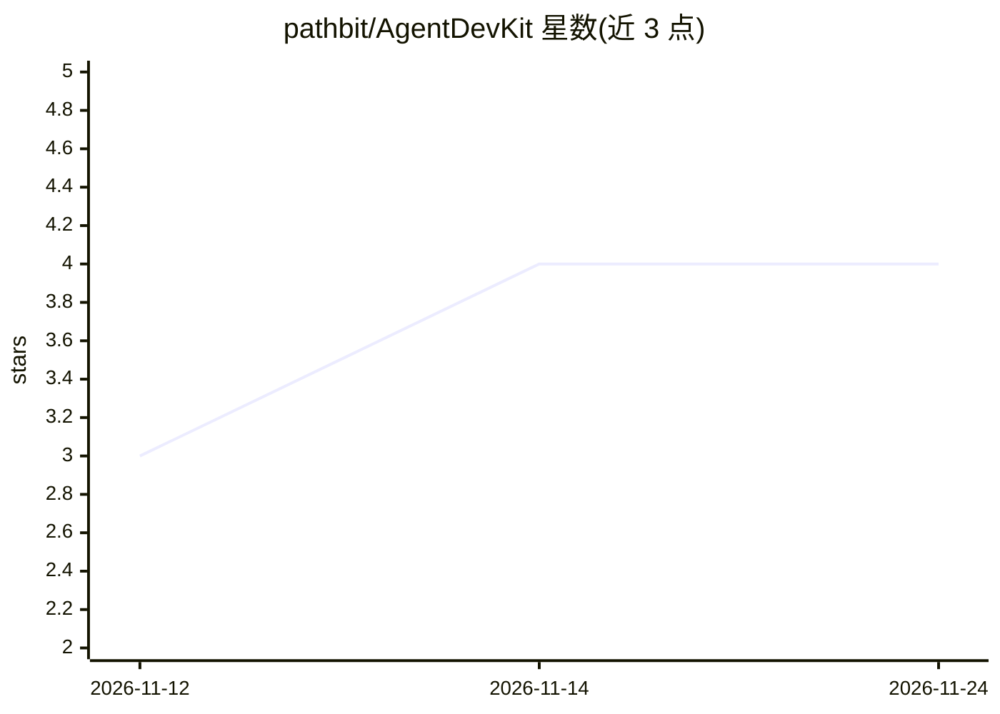

# pathbit/AgentDevKit

⭐ 4 · JavaScript · MIT · 推送 2026-11-23 · [GitHub](https://github.com/pathbit/AgentDevKit) · [官网](https://www.pathbit.com.br) · 组织维护

**为编码 agent 提供统一 skills、命令与工作流的管理套件**

将项目的 skills、规则、命令与配置集中存放在 `.pbai4devs/` 目录，由套件为各编码 agent 客户端生成其各自可发现的引用文件（如 AGENTS.md），覆盖从规划到验证的工作流。支持 Codex、Claude、Cursor、Copilot、OpenCode 等客户端，初始化时可选择目标 agent；对已有项目以带界标的方式追加引用并保留原有内容。通过 npm 公共源或 GitHub Packages 分发，CLI 支持 pt/en/es 三种语言。

## 筛选速览

| 维度 | 判定 | 备注 |
|---|---|---|
| AI 角色 | `ai-ecosystem` | LLM/agent 周边工具 |
| 许可风险 | `permissive` | MIT |
| 部署形态 | `desktop` | 安装包/桌面程序 |
| 模型依赖 | — | README 未给出锁定关系 |
| 硬件要求 | — | 无带数字的原话,不猜 |
| 安装摩擦 | `low` | 无编译、无系统依赖或容器化 |
| 成熟度 | — | 结构信号不足 |

## 能力要点

- 集中管理 skills/规则/命令，为各客户端生成本地发现文件
- 支持 Codex、Claude、Cursor、Copilot、OpenCode 等客户端
- 对已有项目的指令与 skills 以界标块追加并保留原内容
- npm 公共源免登录安装，CLI 支持 pt/en/es

## 适用场景

- 在多个编码 agent 客户端间统一项目的 skills 与工作流约定
- 为现有项目接入 agent 指令而不改动原有文件
- 按规划—实现—验证流程组织 agent 开发工作

## 场景标签

`编码 Agent` · 领域:编码与开发

## 证据(README 行号)

> L10: Uma forma de organizar o trabalho com agentes de código, do planejamento à
> L11: verificação. Você mantém skills, regras, comandos e perfis em `.pbai4devs`;
> L14: Use com Codex, Claude, Cursor, Copilot, OpenCode e outros

## 星数曲线

2026-11-12 3 → 2026-11-24 4（+1）

---
*卡片 v1 · prompt 1.4 · 生成 2026-11-21 · 置信度 high · 依据 README sha `520cc10632e9` · [字段定义](../../DATASET.md)*
