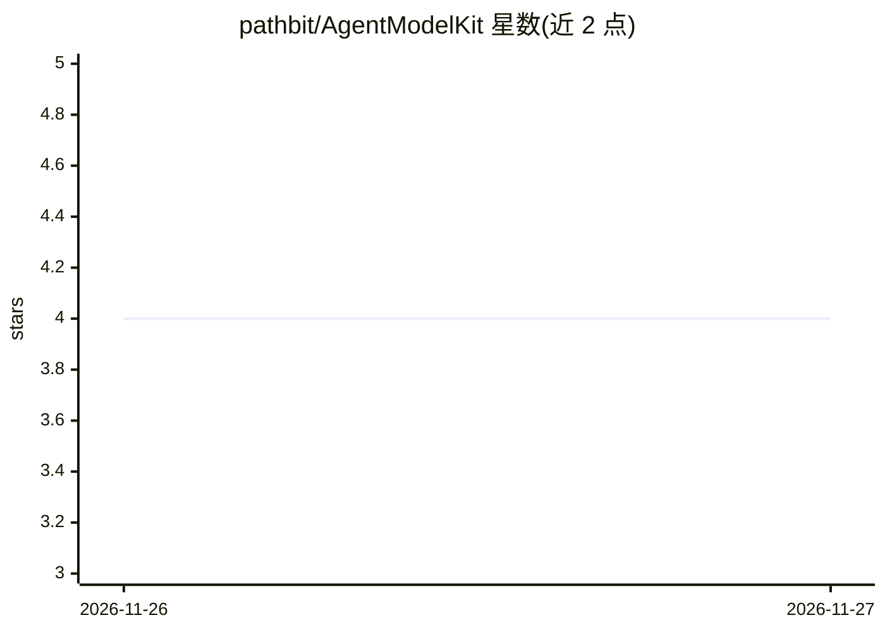

# pathbit/AgentModelKit

⭐ 4 · JavaScript · MIT · 推送 2026-11-26 · [GitHub](https://github.com/pathbit/AgentModelKit) · [官网](https://www.pathbit.com.br) · 组织维护

**为 OpenCode、VS Code 与 Copilot CLI 配置 AI 模型 provider 的 CLI**

一个 Node.js CLI 工具，用于在本地与远程工具中配置 AI 模型 provider：支持向 OpenCode、VS Code、GitHub Copilot CLI 写入配置，支持交互式终端选择器与命令行参数自动化。提供模型目录管理（catalog list/update）、推荐模型选择（--powerful，非 AI 调用而是版本化数据）、失效模型清理（prune）与诊断（doctor）。写配置前生成 .bak 备份，支持 --dry-run 预演；凭据支持环境变量、key 文件或受保护输入。通过 npmjs、GitHub Release tarball 或 Git 仓库直接以 npx 运行，MIT 许可。

## 筛选速览

| 维度 | 判定 | 备注 |
|---|---|---|
| AI 角色 | `ai-ecosystem` | LLM/agent 周边工具 |
| 许可风险 | `permissive` | MIT |
| 部署形态 | `library` | 以包/库形式分发 |
| 模型依赖 | — | README 未给出锁定关系 |
| 硬件要求 | — | 无带数字的原话,不猜 |
| 安装摩擦 | `low` | 无编译、无系统依赖或容器化 |
| 成熟度 | — | 结构信号不足 |

## 能力要点

- 一条命令为 OpenCode / VS Code / Copilot CLI 写入模型 provider 配置
- catalog update/prune/doctor 管理模型目录与失效项
- 写入前自动生成 .bak 备份，--dry-run 不落盘
- 凭据支持 --key-file、环境变量或终端受保护输入

## 适用场景

- 在一台或多台设备上统一配置 AI 模型 provider
- 脚本化批量更新项目中的模型配置
- 清理目录中已下架的模型条目并保留备份

## 场景标签

 · 领域:开发工具/AI 基础设施配置

## 证据(README 行号)

> L6: O AgentModelKit configura providers e modelos de IA no **OpenCode**, no **VS Code** e no **GitHub Copilot CLI**. O C

## 星数曲线

2026-11-26 4 → 2026-11-27 4（+0）

---
*卡片 v1 · prompt 1.4 · 生成 2026-11-26 · 置信度 high · 依据 README sha `c44ed327e63b` · [字段定义](../../DATASET.md)*
