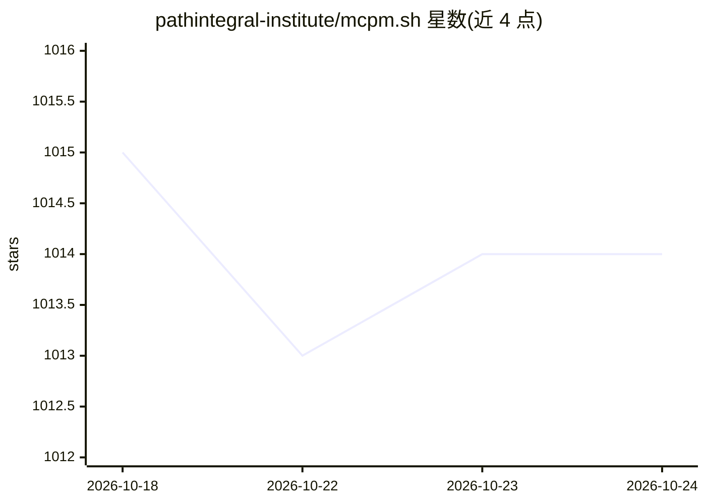

# pathintegral-institute/mcpm.sh

⭐ 1,014 · Python · MIT · 推送 2026-10-20 · [GitHub](https://github.com/pathintegral-institute/mcpm.sh) · [官网](https://mcpm.sh/) · 组织维护 · 中文 README

**面向各 MCP 客户端的 MCP 服务器包管理与注册表 CLI**

由 Path Integral Institute 开发的开源命令行工具，用于管理 MCP（Model Context Protocol）服务器：通过全局配置模型一次安装服务器，用 Profile 标签组织，再集成到 Claude Desktop、Cursor、Cline 等十余种 MCP 客户端。提供中央注册表检索、stdio/HTTP 直连执行、安全隧道分享、git/NPX/二进制服务器更新、使用分析与 AI agent 友好的非交互模式。用 Python + Click 构建，限制：v1 演示视频已过时，Docker 执行等仍在路线图中。

## 筛选速览

| 维度 | 判定 | 备注 |
|---|---|---|
| AI 角色 | `ai-ecosystem` | LLM/agent 周边工具 |
| 许可风险 | `permissive` | MIT |
| 部署形态 | `library` | 以包/库形式分发 |
| 模型依赖 | — | README 未给出锁定关系 |
| 硬件要求 | — | 无带数字的原话,不猜 |
| 安装摩擦 | `low` | 无编译、无系统依赖或容器化 |
| 成熟度 | — | 结构信号不足 |

## 能力要点

- 全局配置模型：服务器一次安装、随处使用，Profile 标签组织工作流
- 中央 MCP Registry 服务器检索与安装（mcpm.sh/registry）
- 支持 Claude Desktop、Cursor、Windsurf、Cline、Continue、Goose 等十余种客户端配置管理
- 非交互模式 + 自动生成的 llm.txt 文档，支持 AI agent 自动化调用

## 适用场景

- 统一管理多个 MCP 客户端的服务器配置，避免重复安装
- 从注册表搜索并安装 MCP 服务器
- 将本地 stdio 服务器以 HTTP 方式暴露或通过隧道分享

## 场景标签

 · 领域:LLM 基础设施/MCP 工具链

## 证据(README 行号)

> L20: MCPM is an open source CLI tool for managing MCP servers. It provides a simplified global configuration approach wh
> L49: - 🎛️ **Client Integration**: Manage configurations for Claude Desktop, Cursor, Windsurf, and more
> L56: ## 🖥️ Supported MCP Clients

## 星数曲线

2026-10-18 1,015 → 2026-10-24 1,014（-1）

---
*卡片 v1 · prompt 1.4 · 生成 2026-10-21 · 置信度 high · 依据 README sha `642ba9a76461` · [字段定义](../../DATASET.md)*
