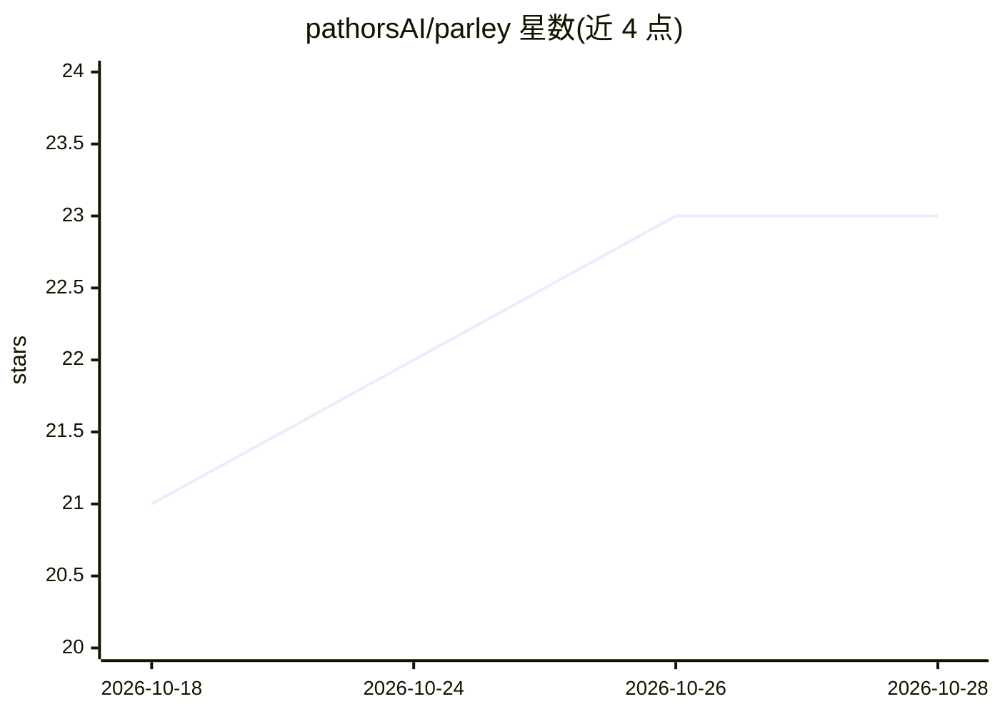

# pathorsAI/parley

⭐ 23 · TypeScript · Apache-2.0 · 推送 2026-10-25 · [GitHub](https://github.com/pathorsAI/parley) · [官网](https://parley.tw) · 组织维护 · 中文 README

**给销售/谈判通话做实时 AI 教练的本地优先 macOS/Windows 应用**

桌面会议助手：录制麦克风与系统音频双侧通话，实时转写并做说话人分离，会中按用户自定义模板给出教练提示与议程勾选，会后生成含承诺、行动项与交付评分卡的 debrief，并对全部历史做全文检索。本地优先，自带 API key，音频与转写直连用户配置的 STT/LLM 提供商（Claude、OpenAI、Gemini、Soniox、Deepgram 等），无遥测。内置本地 MCP 服务器提供 54 个工具，供 Claude、Claude Code、Cursor 等 MCP 客户端读取与回写会议数据；另含全系统语音输入、音频/文本导入、zh-TW 界面。macOS 与 Windows 提供安装包，也可从源码构建。

## 筛选速览

| 维度 | 判定 | 备注 |
|---|---|---|
| AI 角色 | `ai-native` | 本体是模型或模型工具 |
| 许可风险 | `permissive` | Apache-2.0 |
| 部署形态 | `desktop` | 安装包/桌面程序 |
| 模型依赖 | — | README 未给出锁定关系 |
| 硬件要求 | — | 无带数字的原话,不猜 |
| 安装摩擦 | `low` | 无编译、无系统依赖或容器化 |
| 成熟度 | — | 结构信号不足 |

## 能力要点

- 双侧通话实时转写与说话人分离，会中教练提示与自动议程勾选
- 会后 debrief：承诺、行动项、时间线与交付评分卡，生成一次即存档
- 本地 MCP 服务器（54 个工具）供 Claude/Cursor 等客户端检索与接管分析
- 本地优先、自带 key，音频与转写直连用户配置的提供商，无遥测

## 适用场景

- 销售/谈判通话中获取实时教练提示与会后复盘报告
- 跨全部历史录音做全文检索，按客户文件夹归档管理
- 让 Claude/Cursor 等 MCP 客户端读取并重新分析我的会议记录
- 在全系统任意应用里用快捷键做语音输入

## 场景标签

`语音识别` `AI 助手` · 领域:对话与助手

## 证据(README 行号)

> L15: Parley does four things: **record, transcribe, analyze, search**. It captures both sides of a call, gives you a spe
> L24: **Local-first, bring your own keys.** Audio and transcripts go directly to the STT and LLM providers *you* configur

## 星数曲线

2026-10-18 21 → 2026-10-28 23（+2）

---
*卡片 v1 · prompt 1.4 · 生成 2026-10-27 · 置信度 high · 依据 README sha `c9eeaf918c80` · [字段定义](../../DATASET.md)*
