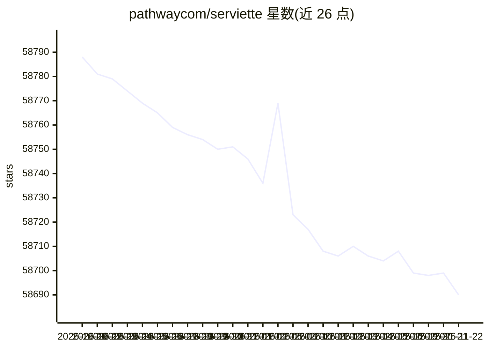

# pathwaycom/serviette

⭐ 58,690 · Python · MIT · 推送 2026-11-10 · [GitHub](https://github.com/pathwaycom/serviette) · [官网](https://github.com/pathwaycom/serviette/blob/main/docs/README.md) · 组织维护

**给企业的文档问答服务器：文档改动秒级同步进答案**

基于 Pathway Live Data Framework 的 no-code RAG 服务器：指向一个文档文件夹，在一个 YAML 文件里选择向量数据库与 embedder，两条命令后即获得带来源引用的 Web 聊天界面与 REST API。文档的编辑、新增、删除在数秒内反映到答案中，无需手动重建索引。索引器与服务器为独立进程，通过向量数据库解耦，可分别扩缩容。需 Pathway 免费许可 key；默认本地 embedder + 内嵌 DuckDB 可零外部服务运行。暂无会话记忆、用户账户与托管版本。

## 筛选速览

| 维度 | 判定 | 备注 |
|---|---|---|
| AI 角色 | `ai-native` | 本体是模型或模型工具 |
| 许可风险 | `permissive` | MIT |
| 部署形态 | `library` | 以包/库形式分发 |
| 模型依赖 | — | README 未给出锁定关系 |
| 硬件要求 | — | 无带数字的原话,不猜 |
| 安装摩擦 | `medium` | 含编译或系统依赖之一 |
| 成熟度 | `idea` | |

## 动量与使用信号

- 维护:`active` — 距上次 push 1.9 天,年发版 0,24 位贡献者
- 涨星:近 1 天 **-5**(自 20261016 起算)
- 安装:pypi 包 `serviette` 月下载 610

## 能力要点

- 文档增删改数秒内实时反映到答案，无需重传或重索引
- 8 种向量数据库后端，默认内嵌 DuckDB 零配置启动
- 多模态解析：文本、Office、PDF（含表格版式）、扫描图、音视频
- 索引器与服务器进程解耦，各自独立扩缩容

## 适用场景

- 为组织内部文档搭建持续同步的问答助手
- 把本地文件夹、Google Drive、S3、SharePoint 等多来源文档统一接入检索
- 用本地 embedder 保持文档数据不出机器
- 为业务系统提供带引用的文档问答 REST API

## 场景标签

`文档问答` · 领域:知识与检索

## 证据(README 行号)

> L12: **A no-code, always up-to-date RAG server for any vector database — built on
> L16: embedder in one YAML file, and run two commands: you get a chat and a REST API
> L48: **What you get.** A question-answering assistant over your organisation's

## 星数曲线

2026-10-20 58,788 → 2026-11-22 58,690（-98）

---
*卡片 v1 · prompt 1.4 · 生成 2026-11-22 · 置信度 high · 依据 README sha `860aeb02ef10` · [字段定义](../../DATASET.md)*
