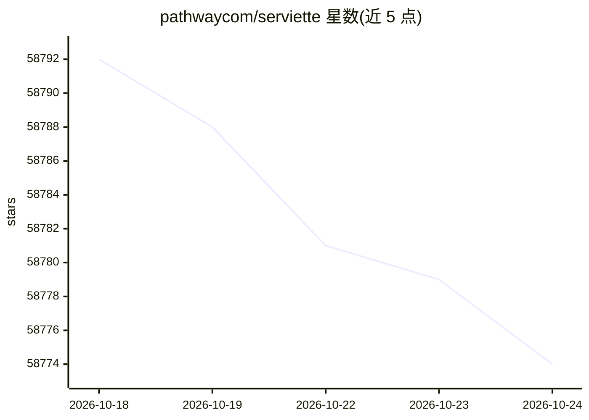

# pathwaycom/serviette

⭐ 58,774 · Python · MIT · 推送 2026-10-16 · [GitHub](https://github.com/pathwaycom/serviette) · [官网](https://github.com/pathwaycom/serviette/blob/main/docs/README.md) · 组织维护

**面向企业和开发者的零代码文档问答 RAG 服务器，答案随文档实时更新**

基于 Pathway Live Data Framework 的 RAG 服务器：指向一个文档目录，在单个 YAML 文件中选择向量数据库与 embedder，运行两条命令即获得带来源引用的聊天界面与 REST API。索引器与服务器为独立进程，仅通过向量数据库耦合；文档的增、改、删在数秒内反映到答案，无需重新上传或重建索引。默认使用内嵌 DuckDB 零配置启动，支持本地免费 embedder。运行需要免费的 Pathway license key；目前一次只回答一个问题，未内置对话记忆、用户账号与托管服务。

## 筛选速览

| 维度 | 判定 | 备注 |
|---|---|---|
| AI 角色 | `ai-native` | 本体是模型或模型工具 |
| 许可风险 | `permissive` | MIT |
| 部署形态 | `library` | 以包/库形式分发 |
| 模型依赖 | locked-api |  |
| 硬件要求 | — | 无带数字的原话,不猜 |
| 安装摩擦 | `medium` | 含编译或系统依赖之一 |
| 成熟度 | — | 结构信号不足 |

## 动量与使用信号

- 维护:`active` — 距上次 push 1.9 天,年发版 0,24 位贡献者
- 涨星:近 1 天 **-5**(自 20261016 起算)
- 安装:pypi 包 `serviette` 月下载 610

## 能力要点

- 8 种向量数据库后端，通过 Pathway 原生连接器写入 upsert/delete
- 文档编辑、新增、删除数秒内同步到答案（实时增量索引）
- 多源接入：本地文件、Google Drive、S3/MinIO、SharePoint、FTP/SFTP/WebDAV/ZIP
- 文本、Office、PDF、扫描图片开箱即用，可配置音频与视频解析

## 适用场景

- 给组织文档搭一个带来源引用、随文档自动更新的问答助手
- 不写代码，用一份 YAML 配置就能跑起的 RAG 服务
- 需要索引和检索能力保持解耦、分别扩缩容的部署场景

## 场景标签

`文档问答` `RAG` · 领域:知识与检索

## 证据(README 行号)

> L12: **A no-code, always up-to-date RAG server for any vector database — built on
> L65: **How mature it is.** serviette is a thin layer over the
> L126: - **Live & incremental.** Built on Pathway: additions, edits and deletions

## 星数曲线

2026-10-18 58,792 → 2026-10-24 58,774（-18）

---
*卡片 v1 · prompt 1.4 · 生成 2026-10-18 · 置信度 high · 依据 README sha `49f034648be0` · [字段定义](../../DATASET.md)*
