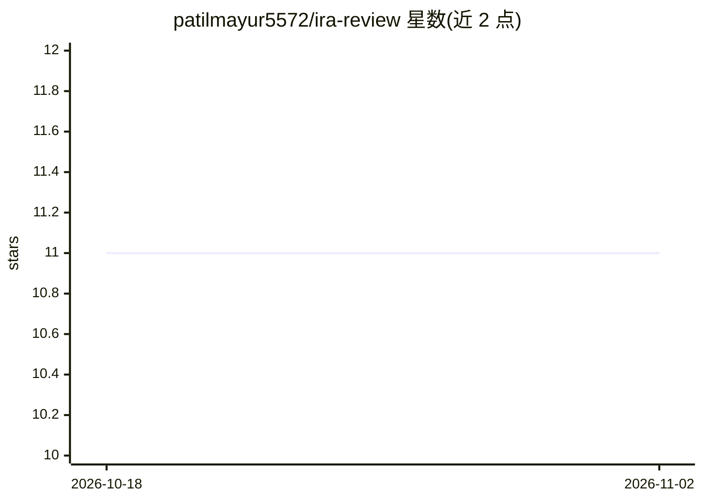

# patilmayur5572/ira-review

⭐ 11 · TypeScript · MIT · 推送 2026-05-12 · [GitHub](https://github.com/patilmayur5572/ira-review) · [官网](https://www.npmjs.com/package/ira-review) · 个人维护

**面向团队的 AI 代码评审工具：读 PR、打分并对照 JIRA 验收**

以 CLI、VS Code 扩展或 CI 流水线三种形态运行的 PR 评审工具。它读取完整 PR diff，经 13 步流水线将变更文件送入 AI 模型分析，输出带严重级别、说明、影响与修复建议的内联评论，并产出 0-100 复合风险评分。可选接入 SonarQube 与 JIRA：前者提供静态问题供 AI 解释，后者用于对照验收标准逐条判定覆盖情况，无验收标准时生成建议 AC。支持自定义规则文件与 Slack/Teams 通知，全部本地执行、无托管服务。

## 筛选速览

| 维度 | 判定 | 备注 |
|---|---|---|
| AI 角色 | `ai-native` | 本体是模型或模型工具 |
| 许可风险 | `permissive` | MIT |
| 部署形态 | `library` | 以包/库形式分发 |
| 模型依赖 | local-ok | 支持本地模型 |
| 硬件要求 | — | 无带数字的原话,不猜 |
| 安装摩擦 | `low` | 无编译、无系统依赖或容器化 |
| 成熟度 | — | 结构信号不足 |

## 能力要点

- 13 步评审流水线，各步骤可软失败（部分配置仍可用）
- 0-100 风险评分并在 GitHub/Bitbucket 上打标签或构建状态
- JIRA 验收标准逐条 pass/fail 判定与覆盖率统计
- 自定义团队规则注入 AI prompt（.ira-rules.json）

## 适用场景

- 在 CI 中对 PR 做第一轮机械性问题的评审
- 核验 PR 是否覆盖 JIRA 工单的验收标准
- 从 JIRA 工单自动生成测试用例（8 种框架）

## 场景标签

`代码审查` · 领域:编码与开发

## 证据(README 行号)

> L3: IRA reviews pull requests before your team does. It reads the full PR diff, runs each changed file through an AI mod
> L5: It runs as a CLI tool, a VS Code extension, or inside CI pipelines. Everything executes locally. No code or credenti
> L52:   ai/           AI provider abstraction (OpenAI, Anthropic, Azure, Ollama, AMP, Copilot CLI)

## 星数曲线

2026-10-18 11 → 2026-11-02 11（+0）

---
*卡片 v1 · prompt 1.4 · 生成 2026-11-01 · 置信度 high · 依据 README sha `a35173024d24` · [字段定义](../../DATASET.md)*
