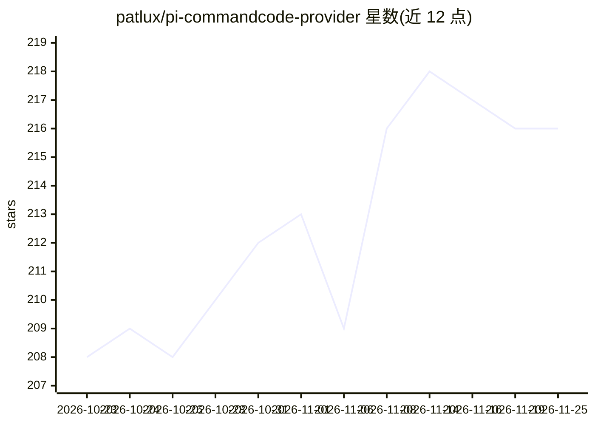

# patlux/pi-commandcode-provider

⭐ 216 · TypeScript · MIT · 推送 2026-11-23 · [GitHub](https://github.com/patlux/pi-commandcode-provider) · [官网](https://pi.dev/packages/pi-commandcode-provider) · 个人维护

**为 pi 接入 Command Code API 的自定义模型提供者扩展**

pi 编码代理的自定义 provider 扩展（npm 包），将 Command Code Provider API 的 18 个模型接入 pi 与 Oh My Pi 宿主。机制包括：/login 浏览器登录或粘贴 API key、从多路径读取既有凭据、按 /provider/v1/models 的 supported_endpoints 字段自动匹配 Anthropic Messages/OpenAI Responses/Chat Completions 三种线路、/commandcode-endpoint 持久化覆盖路由、模型目录缓存离线可用，以及 /commandcode-status 与 /commandcode-diagnostics 诊断命令。限制：需具备 Provider API 权限的付费计划，Go 计划不含 API 访问；社区维护、非官方。

## 筛选速览

| 维度 | 判定 | 备注 |
|---|---|---|
| AI 角色 | `ai-ecosystem` | LLM/agent 周边工具 |
| 许可风险 | `permissive` | MIT |
| 部署形态 | `None` |  |
| 模型依赖 | — | README 未给出锁定关系 |
| 硬件要求 | — | 无带数字的原话,不猜 |
| 安装摩擦 | `low` | 无编译、无系统依赖或容器化 |
| 成熟度 | — | 结构信号不足 |

## 能力要点

- 支持 pi 与 Oh My Pi 两种宿主，npm 包一键安装
- 按模型 supported_endpoints 自动选择 Messages/Responses/Chat Completions 线路
- 模型目录本地缓存，后台刷新，离线启动不阻塞
- /commandcode-status 与 /commandcode-diagnostics 提供脱敏诊断报告

## 适用场景

- 在 pi 中通过订阅账号使用 Command Code 提供的多家模型
- 为不同模型固定或重置推理端点线路
- 排查模型目录、凭据与请求状态问题

## 场景标签

`模型网关` · 领域:Agent 开发

## 证据(README 行号)

> L6: A custom provider for pi that connects to the Command Code Provider API.
> L23: pi install npm:pi-commandcode-provider

## 星数曲线

2026-10-23 208 → 2026-11-25 216（+8）

---
*卡片 v1 · prompt 1.4 · 生成 2026-11-25 · 置信度 high · 依据 README sha `4cafdd1a87b7` · [字段定义](../../DATASET.md)*
