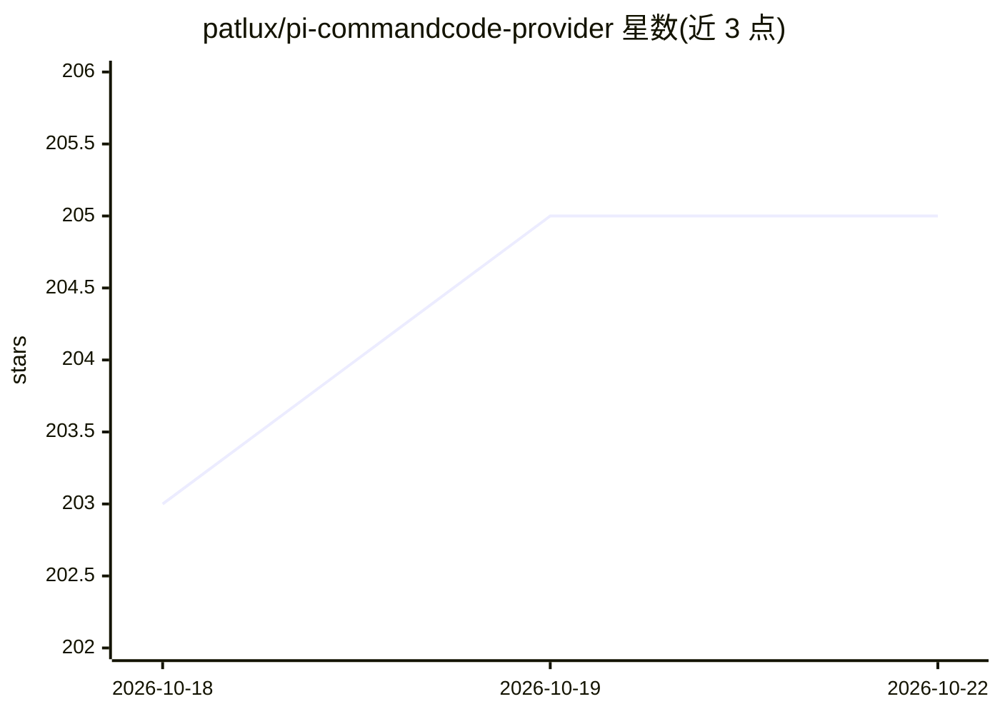

# patlux/pi-commandcode-provider

⭐ 205 · TypeScript · MIT · 推送 2026-10-21 · [GitHub](https://github.com/patlux/pi-commandcode-provider) · [官网](https://pi.dev/packages/pi-commandcode-provider) · 个人维护

**为 pi/OMP 接入 Command Code API 的自定义 provider 扩展**

非官方社区维护的 pi 扩展包，把 pi 与 Oh My Pi（OMP）连接到 Command Code Provider API，暴露 Claude、GPT、DeepSeek、Kimi、GLM、MiniMax、Qwen 等 18 个模型。机制包括：从 Provider API 拉取并缓存模型目录（离线时用缓存）、按模型自动映射 Anthropic/OpenAI Responses/Chat Completions 三种协议线、浏览器登录或 API key 认证、/commandcode-quota 查看账户用量、静态价格表展示估算成本。限制：需自备 Command Code 账户与 Provider API 计划，价格显示仅供参考。

## 筛选速览

| 维度 | 判定 | 备注 |
|---|---|---|
| AI 角色 | `ai-ecosystem` | LLM/agent 周边工具 |
| 许可风险 | `permissive` | MIT |
| 部署形态 | `None` |  |
| 模型依赖 | — | README 未给出锁定关系 |
| 硬件要求 | — | 无带数字的原话,不猜 |
| 安装摩擦 | `low` | 无编译、无系统依赖或容器化 |
| 成熟度 | — | 结构信号不足 |

## 能力要点

- 模型目录在线刷新与本地缓存，离线启动不阻塞
- 按模型自动映射 Anthropic Messages / OpenAI Responses / Chat Completions 协议
- 支持浏览器登录、API key、环境变量与 auth 文件多种认证方式
- 提供 /commandcode-refresh、/commandcode-status、/commandcode-quota 等运行时命令

## 适用场景

- 在 pi 或 Oh My Pi 中通过 Command Code 订阅使用多家模型
- 查看 Command Code 账户额度与 5 小时/每周用量窗口
- 在对话中展示模型请求的估算成本

## 场景标签

 · 领域:LLM 基础设施/模型接入

## 证据(README 行号)

> L6: A custom provider for pi that connects to the Command Code Provider API.
> L8: > **Disclaimer:** This is an unofficial, community-maintained integration. It is not affiliated with, endorsed by, o

## 星数曲线

2026-10-18 203 → 2026-10-22 205（+2）

---
*卡片 v1 · prompt 1.4 · 生成 2026-10-22 · 置信度 high · 依据 README sha `bae3203b8258` · [字段定义](../../DATASET.md)*
