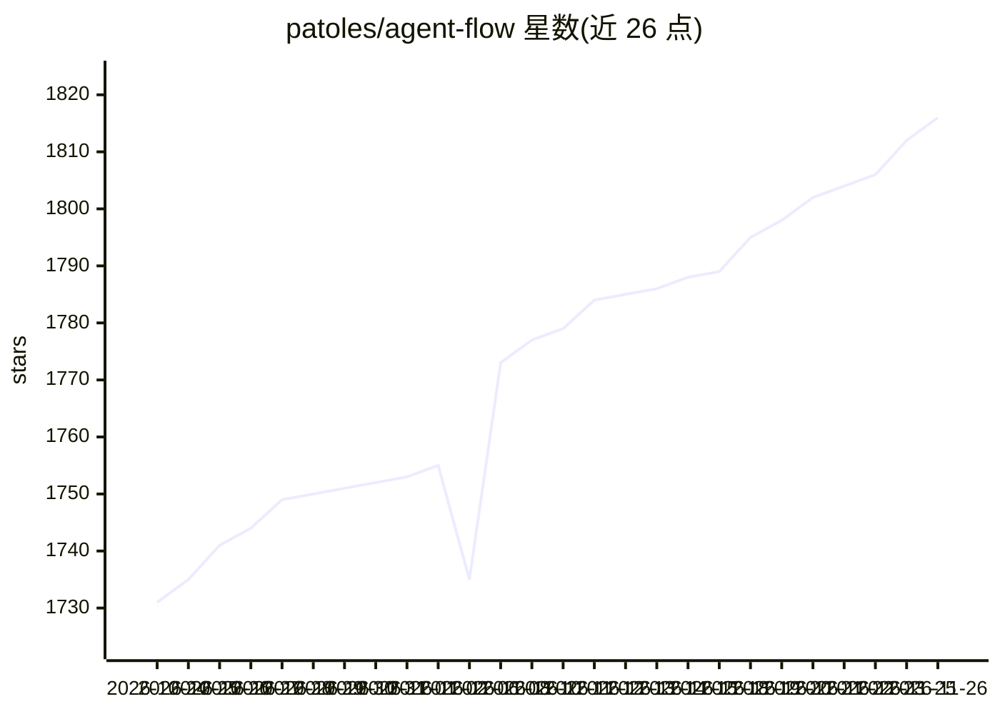

# patoles/agent-flow

⭐ 1,816 · TypeScript · Apache-2.0 · 推送 2026-11-20 · [GitHub](https://github.com/patoles/agent-flow) · [官网](https://marketplace.visualstudio.com/items?itemName=simon-p.agent-flow) · 个人维护

**可视化 Claude Code/Codex agent 执行过程的调试工具**

以交互式节点图实时展示 Claude Code 与 Codex agent 会话的执行过程：工具调用、分支、子 agent 协作与返回流。通过 Claude Code hooks 的 HTTP 服务器接收事件，通过读取 Codex rollout JSONL 文件获取事件流；支持多会话标签页、时间线、转录面板与文件关注热力图，也可回放任意 JSONL 事件日志。提供 VS Code 扩展、npx 浏览器版与源码运行三种入口，要求 Node.js 20+ 与 Claude Code CLI。

## 筛选速览

| 维度 | 判定 | 备注 |
|---|---|---|
| AI 角色 | `ai-ecosystem` | LLM/agent 周边工具 |
| 许可风险 | `permissive` | Apache-2.0 |
| 部署形态 | `library` | 以包/库形式分发 |
| 模型依赖 | — | README 未给出锁定关系 |
| 硬件要求 | — | 无带数字的原话,不猜 |
| 安装摩擦 | `low` | 无编译、无系统依赖或容器化 |
| 成熟度 | — | 结构信号不足 |

## 能力要点

- 实时节点图展示 agent 工具调用、分支与子 agent 协调
- 同时自动检测 Claude Code 与 Codex 会话并可按运行时过滤
- Claude Code hooks HTTP 服务器接收事件流；支持 JSONL 日志回放
- 提供 VS Code 扩展 / npx 浏览器版 / 源码三种运行入口

## 适用场景

- 调试 agent 工具调用链，追踪出错的决策序列
- 观察 agent 行为以改进提示词
- 定位耗时的工具调用与冗余分支

## 场景标签

`LLM 可观测性` · 领域:评测与运维

## 证据(README 行号)

> L3: Real-time visualization of Claude Code and Codex agent orchestration. Watch your agents think, branch, and coordinat
> L22: - **Live agent visualization**: Watch agent execution as an interactive node graph with real-time tool calls, branc
> L24: - **Claude Code hooks**: Lightweight HTTP hook server receives events directly from Claude Code for zero-latency st

## 星数曲线

2026-10-24 1,731 → 2026-11-26 1,816（+85）

---
*卡片 v1 · prompt 1.4 · 生成 2026-11-23 · 置信度 high · 依据 README sha `d2bac4ca0b72` · [字段定义](../../DATASET.md)*
