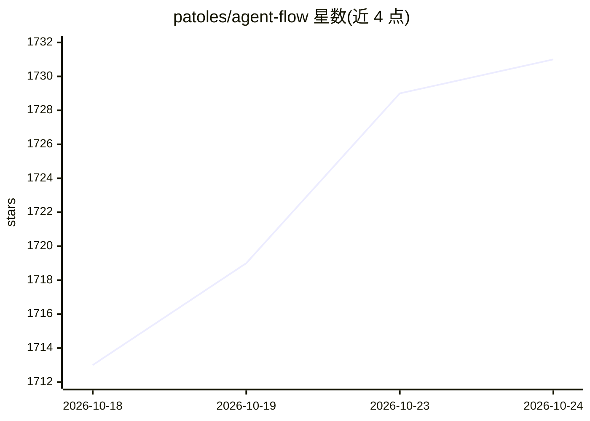

# patoles/agent-flow

⭐ 1,731 · TypeScript · Apache-2.0 · 推送 2026-10-10 · [GitHub](https://github.com/patoles/agent-flow) · [官网](https://marketplace.visualstudio.com/items?itemName=simon-p.agent-flow) · 组织维护

**Claude Code/Codex agent 执行的实时可视化工具**

面向使用 Claude Code 与 Codex CLI 的开发者，实时读取其会话事件（hooks HTTP 服务器、rollout JSONL 文件、JSONL 事件日志），以交互式节点图展示 agent 的思考、分支、工具调用与协调过程，并提供时间线、转录与文件注意力热力图面板。支持多会话标签页与双运行时并发监视。提供 npx 一键启动浏览器版、pnpm 源码运行与 VS Code 扩展三种入口。默认遥测仅在内置 npx 二进制中开启，可环境变量关闭。

## 筛选速览

| 维度 | 判定 | 备注 |
|---|---|---|
| AI 角色 | `ai-ecosystem` | LLM/agent 周边工具 |
| 许可风险 | `permissive` | Apache-2.0 |
| 部署形态 | `library` | 以包/库形式分发 |
| 模型依赖 | — | README 未给出锁定关系 |
| 硬件要求 | — | 无带数字的原话,不猜 |
| 安装摩擦 | `low` | 无编译、无系统依赖或容器化 |
| 成熟度 | — | 结构信号不足 |

## 能力要点

- 实时节点图展示 agent 分支、工具调用与返回流
- 同时监视 Claude Code 与 Codex 会话，可按 runtime 限定
- 通过 Claude Code hooks 实现 HTTP 事件流式接收
- 支持任意 JSONL 事件日志回放与监视

## 适用场景

- 调试 Claude Code/Codex agent 的工具调用链与决策序列
- 定位 agent 执行中耗时或冗余的分支与调用
- 通过观察 agent 解读提示词的方式改进提示词写法

## 场景标签

`LLM 可观测性` · 领域:评测与运维

## 证据(README 行号)

> L20: - **Live agent visualization**: Watch agent execution as an interactive node graph with real-time tool calls, branc
> L22: - **Claude Code hooks**: Lightweight HTTP hook server receives events directly from Claude Code for zero-latency st

## 星数曲线

2026-10-18 1,713 → 2026-10-24 1,731（+18）

---
*卡片 v1 · prompt 1.4 · 生成 2026-10-21 · 置信度 high · 依据 README sha `fbbc995cdcbc` · [字段定义](../../DATASET.md)*
