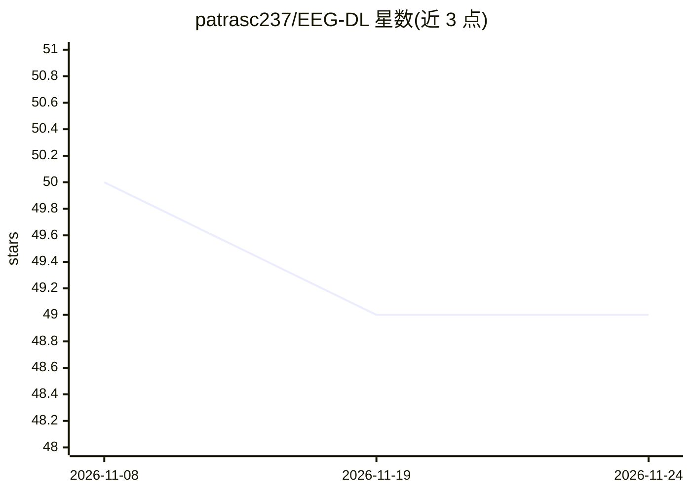

# patrasc237/EEG-DL

⭐ 49 · Python · MIT · 推送 2026-11-05 · [GitHub](https://github.com/patrasc237/EEG-DL) · 个人维护

**给科研者的 EEG 信号分类深度学习库（TensorFlow，26 种网络）**

基于 TensorFlow 1.13.1（Python 3.6 推荐）编写的 EEG 信号/任务分类深度学习库，提供 26 种网络架构实现，包括 CNN、ResNet、DenseNet、GCN/ResGCN/DenseGCN、RNN/LSTM/GRU 系列（含 Attention 与双向变体）、Bayesian CNN、Transformer 及两阶段迁移学习流程。内置 EEG 运动想象基准数据集的下载、读取、Matlab 预处理与训练/评测脚本，评估指标含混淆矩阵、Accuracy/Precision/Recall/F1/Kappa、ROC/AUC 与配对 t 检验。限制：数据预处理环节依赖 Python 2.7 与 Matlab，指标主要面向四分类，需改代码适配其他类别数；文件在 macOS 上测试。

## 筛选速览

| 维度 | 判定 | 备注 |
|---|---|---|
| AI 角色 | `ai-native` | 本体是模型或模型工具 |
| 许可风险 | `permissive` | MIT |
| 部署形态 | `library` | 以包/库形式分发 |
| 模型依赖 | — | README 未给出锁定关系 |
| 硬件要求 | — | 无带数字的原话,不猜 |
| 安装摩擦 | `low` | 无编译、无系统依赖或容器化 |
| 成熟度 | — | 结构信号不足 |

## 能力要点

- 26 种网络架构：CNN/ResNet/DenseNet/GCN 系列/RNN-LSTM-GRU（含 Attention 与双向变体）/Bayesian CNN/Transformer
- 内置 EEG 运动想象基准数据集（MIND_Get_EDF）完整流程脚本
- 评估指标覆盖混淆矩阵、F1/Kappa、ROC/AUC 与配对 t 检验
- 支持 Tensorboard 查看训练过程与指标导出

## 适用场景

- 我在做 EEG 运动想象分类研究，想直接套用多种 SOTA 网络对比实验
- 我需要复现论文中的 GCN/Transformer 等模型做脑电分类
- 我想用统一的评测指标（Kappa、ROC 等）比较不同模型效果

## 场景标签

`科研工具` · 领域:学习与行业

## 证据(README 行号)

> L7: **EEG-DL** is a Deep Learning (DL) library written by TensorFlow for EEG Tasks (Signals) Classification. It provides
> L80: 4. ***(Prerequsites)*** Train and test deep learning models **under the Python 3.6 Environment (Highly Recommended)

## 星数曲线

2026-11-08 50 → 2026-11-24 49（-1）

---
*卡片 v1 · prompt 1.4 · 生成 2026-11-18 · 置信度 mid · 依据 README sha `d38e8ef9813d` · [字段定义](../../DATASET.md)*
